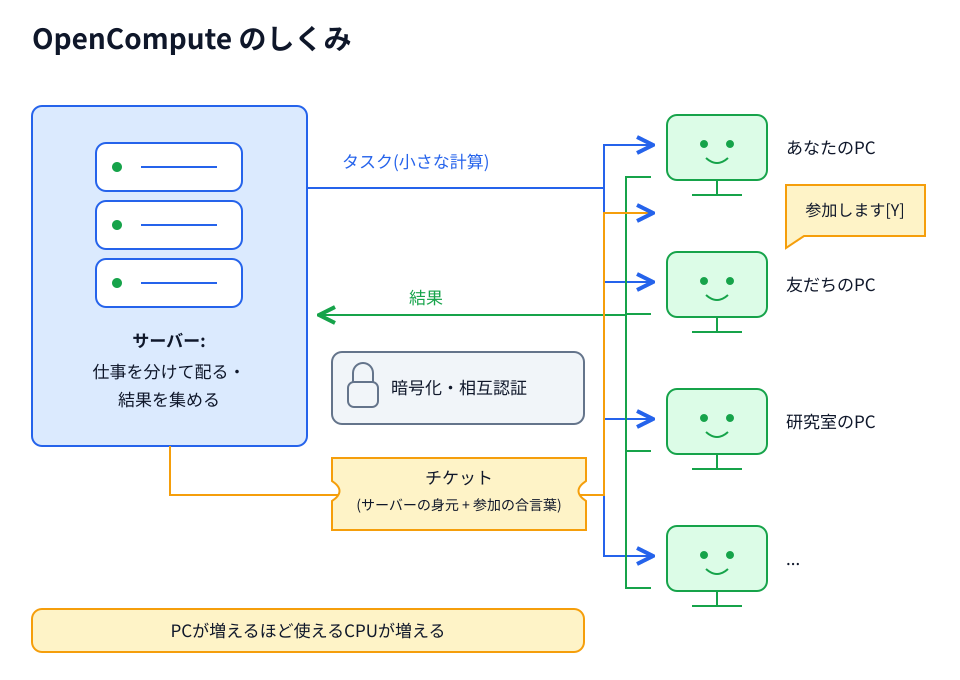
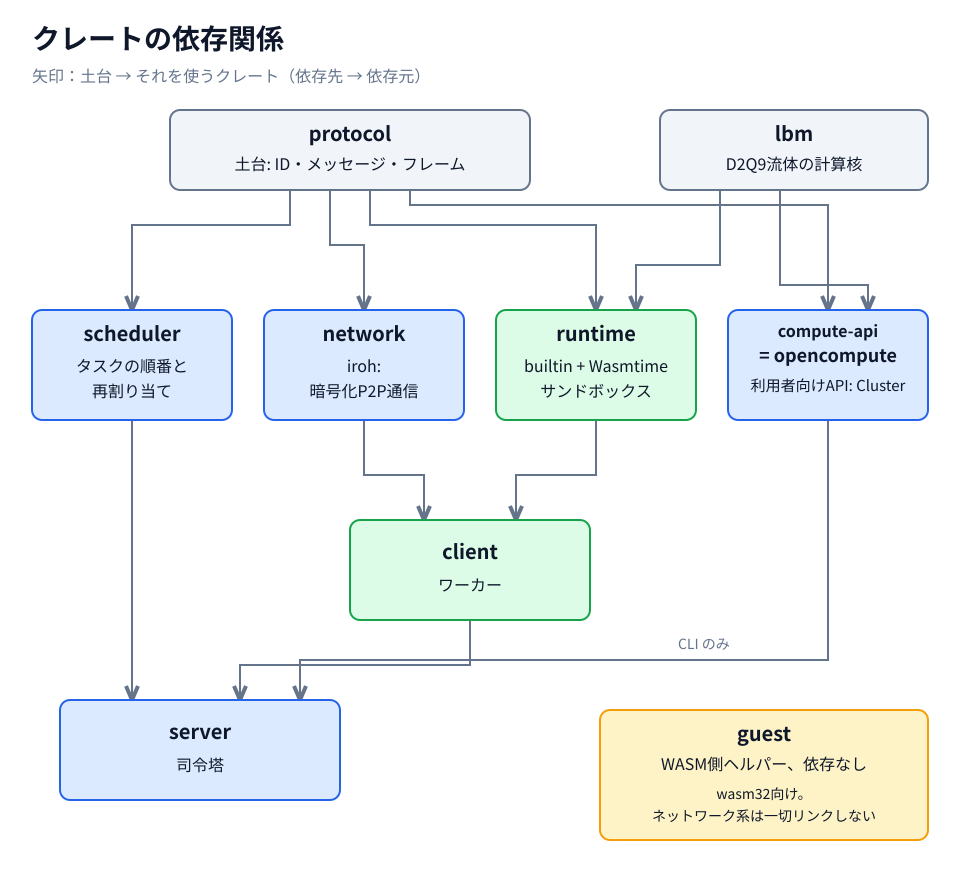

# OpenCompute



OpenCompute は、複数のコンピュータの CPU をネットワークでつなぎ、大きな計算を分担して実行する Rust 製の P2P 分散計算フレームワークです。サーバーが仕事を小さなタスクに分けて配り、参加したクライアントが計算して結果を返します。

状況: フェーズ 1〜4 の初版を実装しました。動作確認は 1 台のマシン上だけです。複数台の LAN、NAT の内側、`--relay` は未検証です(下の「できていないこと」)。

## 特徴

- 暗号化された P2P 通信。iroh(QUIC)を使い、公開鍵で相互に認証します。
- 参加は、利用者が確認に `y` と答えたときだけです。Ctrl-C でいつでも抜けられます。
- 計算は、組み込みの関数か、サンドボックス内の WASM(Wasmtime)です。ファイル・ネットワーク・OS コマンドには触れません。
- クライアントが止まっても続行します。ハートビートの途切れを検知し、タスクを別のクライアントに回します。
- サーバーを再起動しても、ジョブ・結果・チェックポイントを復元します。
- 遅延の大きい回線でも速くするため、境界の行を深く持って交換の回数を減らす「深いハロ」に対応します(自動調整つき)。片道 10 ms を再現した実験で、毎ステップ交換の 13.6 秒が 2.5 秒になりました。実際のネットワークでは未測定です。
- ステップを繰り返す計算にも対応します。例として、2 次元の流体シミュレーション(D2Q9 格子ボルツマン法)を、クライアント間の直接通信、チェックポイントからの巻き戻し、参加・離脱に応じた領域の再分割つきで分散実行できます。結果は、1 プロセスで計算した場合とビット単位で一致します。

## 動かしてみる

必要なものは Rust のツールチェーンです。

```bash
cargo build --release

# ターミナル 1: サーバー(チケットが表示される)
target/release/opencompute-server start --local-worker-cores 2
#   ticket = oc1...

# ターミナル 2, 3: クライアント(確認が出るので読んで y と答える)
target/release/opencompute-client join --server <TICKET> --cores 2 --name A --data-dir /tmp/a
target/release/opencompute-client join --server <TICKET> --cores 2 --name B --data-dir /tmp/b

# ターミナル 4: 状況の確認と、素数を数える計算の投入
target/release/opencompute-server nodes
target/release/opencompute-server submit prime-count --upto 2000000 --tasks 100
```

200 万未満の素数は 148933 個です。クライアントを `kill -9` で止める実演を含む、自動の受け入れ確認は `PROFILE=release scripts/demo-local.sh` です。手順の詳細は [docs/02-quickstart.md](docs/02-quickstart.md) にあります。

自分の計算を WASM にして動かす方法は [docs/04-write-a-module.md](docs/04-write-a-module.md)、流体シミュレーションは [docs/05-stateful-lbm.md](docs/05-stateful-lbm.md) です。

## ドキュメント

図の多い日本語の解説が [`docs/`](docs/README.md) にあります。

| 読みたいこと | 文書 |
|---|---|
| 何ができるのか | [01 OpenCompute とは](docs/01-overview.md) |
| 動かし方 | [02 動かしてみる](docs/02-quickstart.md) |
| 用語 | [03 用語と基本の考え方](docs/03-concepts.md) |
| 自作の計算 | [04 計算モジュールを書く](docs/04-write-a-module.md) |
| 繰り返し計算 | [05 繰り返し計算と流体シミュレーション](docs/05-stateful-lbm.md) |
| 参加者向けの安全性 | [06 安全性と参加者のための説明](docs/06-safety.md) |
| 運用 | [07 運用とトラブルシューティング](docs/07-operations.md) |
| 内部構造 | [08 内部構造](docs/08-architecture.md) |
| 通信仕様(英語) | [PROTOCOL.md](docs/PROTOCOL.md) |

## 構成

| クレート | 役割 |
|---|---|
| `protocol` | ID、メッセージ、postcard のフレーム(サイズ上限つき) |
| `scheduler` | タスクの順番・再試行・タイムアウト・ノード喪失を扱う、I/O を持たない状態機械 |
| `network` | iroh のラッパー、チケット、鍵ファイル |
| `runtime` | タスクの実行。組み込み関数と、Wasmtime のサンドボックス |
| `client` | ワーカー。参加、ハートビート、並列実行、再接続 |
| `server` | 司令塔。受け付け、割り当て、死活監視、保存、制御用ソケット、CLI |
| `compute-api`(`opencompute`) | 利用者向け API。`Cluster` |
| `lbm` | D2Q9 流体の計算核(I/O なし) |
| `guest` | WASM 側のヘルパー(`export_task!`) |
| `examples/wasm-modules` | `hello-world`、`fibonacci`(別ワークスペース、`wasm32-unknown-unknown`) |



## 複数台で使う(未検証)

サーバー側で `opencompute-server start` を実行してチケットを控え、各クライアントで `opencompute-client join --server <TICKET>` を実行します。UDP が通る必要があります。インターネット越しでは両側に `--relay` を付けますが、その場合は第三者(n0)のリレーと DNS サーバーに接続します。付けなければ、これらには接続しません。この構成は動作を確かめていません。

## 安全性

- 相互認証: クライアントはチケットの公開鍵に接続し、サーバーはトークンを確認します。
- WASM: `import` を持てません。メモリ・燃料(命令数)・実時間に上限があります。
- 入力の検証: フレームの長さは確保の前に検査し、モジュールと入出力は BLAKE3 で確認します。古い試行の結果は捨てます。
- 制御用ソケット(`control.sock`、権限 0600)は信頼する前提です。開ける人は誰でもジョブを投げられます。Unix のみです。
- 悪意のあるクライアントが返す誤った結果は、見つけられません。

詳細は [docs/06-safety.md](docs/06-safety.md) にあります。

## できていないこと

- CPU 使用率(%)の制限は未実装です。制限できるのは並列数(コア数)とメモリです。
- ネイティブコードの実行モードは未実装です。WASM と組み込み関数だけです。
- 流体シミュレーションは D2Q9 のチャネル流れだけです。障害物や他の境界条件はありません。
- 動作確認と性能測定は、1 台のマシンのループバック上だけです。直接通信の効果は、そこでは小さく出ました(512×512、300 ステップ、4 クライアントで、サーバー中継 1.62 秒に対し直接 1.1〜1.6 秒)。ネットワークをまたぐ環境での効果は未測定です。再現は `scripts/bench-lbm.sh 512 512 300` です。
- NAT の内側の相手との直接通信は、つながらなければ 2 回の停滞(40 秒以上)のあとサーバー中継に切り替わります。
- 深いハロは LBM カーネルだけが対応しています。待ち時間の計測は、ハローを待った時間から求めていて、RTT を測る専用の通信はありません。拠点ごとの RTT で strip の並び順を決めることと、PC の速さに比例した strip の大きさは、未実装です。
- サーバー自身のワーカーには、直接モードの領域を割り当てません。
- ステートフルな領域は、バッチ用のスロットに数えていません。両方を同時に流すと、コアを使いすぎることがあります。
- ジョブと結果の状態は、サーバーが解放しません。メモリと `state.bin` が増え続けます。
- キャンセルしても、実行中のタスクは中断しません。結果を捨てるだけです。
- サーバーのアドレスは、`--bind` で固定しない限り再起動のたびに変わり、クライアントには新しいチケットが要ります。
- Windows と macOS は未確認です。制御用ソケットが Unix 専用です。

## 開発

```bash
cargo fmt --all && cargo clippy --workspace --all-targets -- -D warnings && cargo test --workspace
```

デモスクリプトは `scripts/` にあります(`demo-local.sh`、`demo-lbm-failure.sh`、`demo-restart.sh`、`demo-direct.sh`、`bench-lbm.sh`)。
