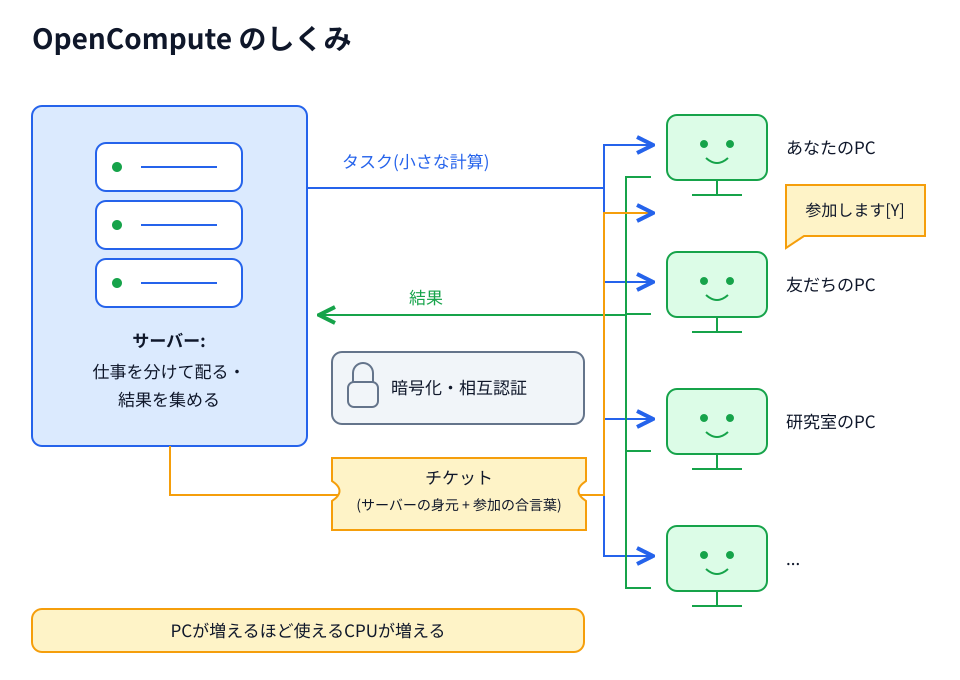
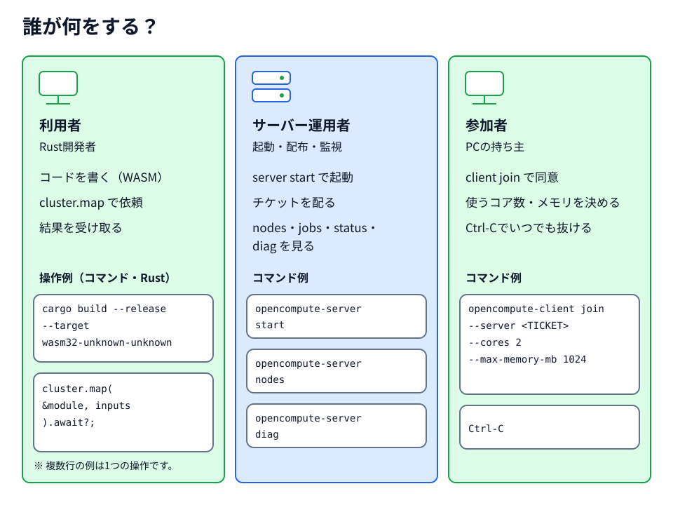
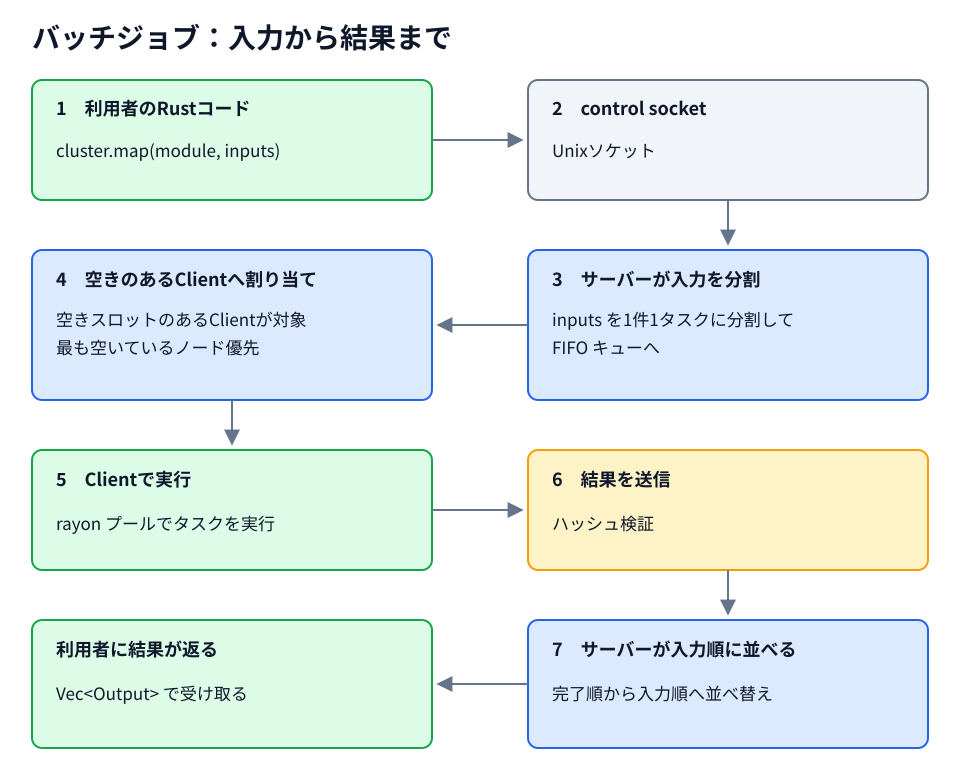
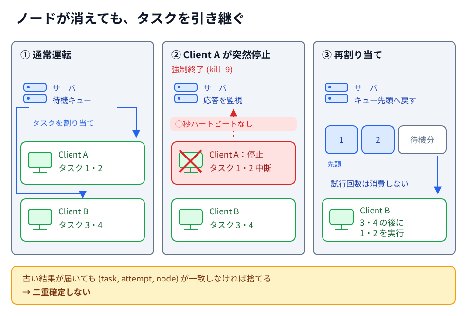
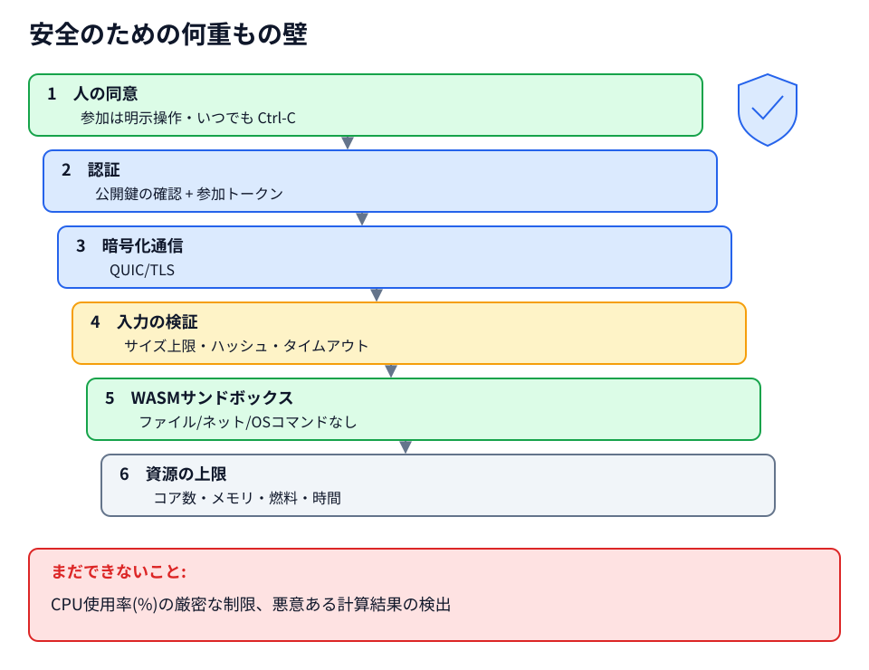

# 01 OpenCompute とは

OpenCompute は、何台かのコンピュータをネットワークでつなぎ、1台では時間のかかる計算を分担して実行するための Rust 製フレームワークです。計算を頼む側と、CPU を貸す側が、どちらも自分のマシンでプログラムを1つ動かすだけで使えます。

## 何を解決するのか

たとえば、100万件の入力それぞれに同じ計算をしたいとします。1台の PC なら順番に処理するので、CPU のコア数だけ速くなります。そこに、ほかの PC のコアも使えれば、さらに速くなります。

OpenCompute は、この「ほかの PC のコアを使う」部分を引き受けます。仕事を小さな単位(タスク)に分けて配ること、途中で PC が止まったら別の PC にやり直させること、結果を集めて元の順序に並べることを、フレームワークが行います。

## 3つの立場

OpenCompute を使う人は、次の3つの立場のどれかにいます。1人が複数の立場を兼ねてもかまいません。

- 利用者は、計算の中身を Rust で書き、`Cluster` という窓口からタスクを投げます。
- サーバー運用者は、`opencompute-server` を起動し、表示された「チケット」を参加者に渡します。
- 参加者は、自分の PC で `opencompute-client join` を実行し、画面の確認に `y` と答えて参加します。使うコア数とメモリの上限は参加者が決め、Ctrl-C でいつでも抜けられます。

## 2種類の計算

OpenCompute は、性質の違う2種類の計算を扱います。

1. バッチ計算。入力が1件ずつ独立していて、タスク同士が話し合わない計算です。素数の個数を数える、パラメータを変えて何度もシミュレーションする、といった用途に向きます。計算の中身は、組み込みのものか、WASM(WebAssembly)にコンパイルした自作のコードです。流れは [図で見るバッチ計算](#バッチ計算の流れ) にあります。
2. ステートフル計算。時間を1ステップずつ進めながら、隣り合う担当同士で境界のデータを交換し続ける計算です。この種類の例として、2次元の流体シミュレーション(D2Q9 格子ボルツマン法)を実装しています。詳しくは [05 繰り返し計算と流体シミュレーション](05-stateful-lbm.md) にあります。

### バッチ計算の流れ

## 壊れても続ける

参加している PC は、突然止まることがあります。OpenCompute は次の方法でこれに備えています。

- 参加者は数秒ごとにハートビート(生存の知らせ)を送ります。途切れたらサーバーがその PC を「消えた」と判断し、そこで実行中だったタスクを待ち行列の先頭に戻します。
- タスクが失敗したりタイムアウトしたりしても、決められた回数まで再試行します。
- サーバーを再起動しても、ジョブと結果は `state.bin` から復元されます。

## 安全のために

他人の PC で計算させるには、参加者が安心できる仕組みが要ります。OpenCompute は、同意・認証・暗号化・入力の検証・WASM サンドボックス・資源の上限を重ねています。詳しくは [06 安全性と参加者のための説明](06-safety.md) にあります。

## 今できること・できないこと

できること(すべて1台のマシン上でテストと実演を確認しています)。

- 複数のクライアントプロセスの参加、タスクの分配、結果の集約
- クライアントの強制終了(`kill -9`)からの回復
- WASM モジュールの配布と、サンドボックス内での実行
- サーバーの再起動からの復元
- 流体シミュレーションの分散実行。結果は、1つのプロセスで計算した場合とビット単位で一致します。
- クライアント同士の直接通信による境界交換、参加・離脱に応じた領域の再分割

できていないこと、確かめていないこと。

- CPU 使用率(%)の上限指定は未実装です。制限できるのは、並列に動かすタスク数(コア数)とメモリです。
- ネイティブコードをそのまま実行するモードは未実装です。ユーザーのコードは WASM で動かします。
- 流体シミュレーションは、D2Q9 のチャネル流れだけです。
- 検証は1台のマシンのループバック上だけです。別々のマシンをつないだ LAN、NAT の内側の PC、`--relay` を使った接続は未検証です。
- 直接通信のメリットは、ループバックでは小さく出ます。ネットワークをまたぐ環境での効果は未測定です。
- サーバー自身のワーカーには、直接通信の担当を割り当てていません。
- ジョブと結果のデータは、サーバーが自動で消すことはありません。

## 次に読むもの

- 動かしてみたい: [02 動かしてみる](02-quickstart.md)
- 言葉を整理したい: [03 用語と基本の考え方](03-concepts.md)
