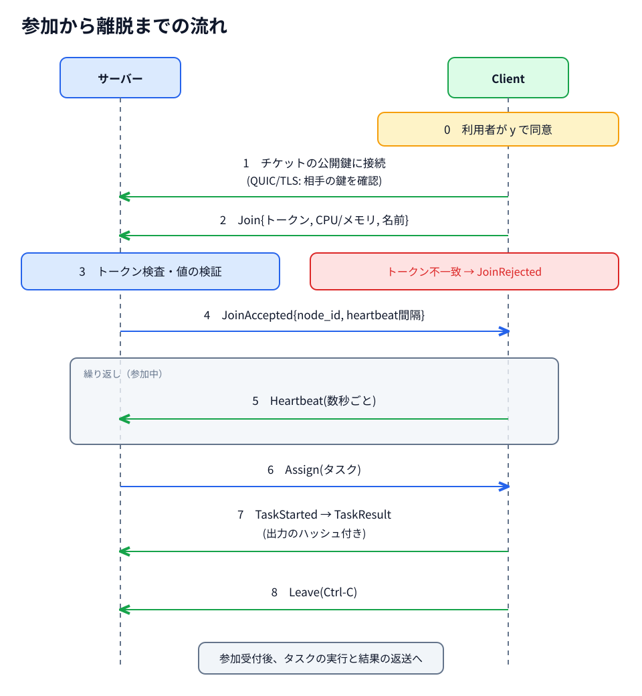
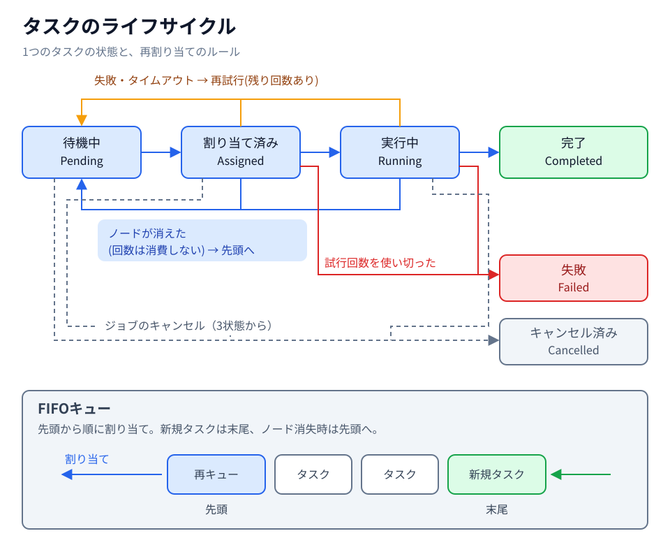

# 02 動かしてみる

この章では、1台の PC の中で OpenCompute を動かします。サーバーとクライアントを別々のターミナルで起動するので、複数台の構成と同じ手順で試せます。

## 準備

必要なものは Rust のツールチェーン(`cargo`)です。リポジトリのルートで、先にビルドしておきます。

```bash
cargo build --release
```

以降のコマンドは、`target/release/` にできた実行ファイルを使います。`cargo run --release -p opencompute-server -- ...` の形でも同じです。

## 手順 1: サーバーを起動する

ターミナル A で、サーバーを起動します。

```bash
target/release/opencompute-server --data-dir /tmp/oc-server start
```

起動すると、次のような行が表示されます。

```
ticket = oc1...(長い16進数)
```

この `oc1` で始まる文字列が「チケット」です。サーバーの身元(公開鍵とアドレス)と、参加用の合言葉(トークン)が入っています。参加者にはこのチケットを渡します。サーバーの身元が入っているので、クライアントは接続先が本物のサーバーかどうかを確かめられます。

`--data-dir` は、鍵・トークン・保存データ・制御用ソケットを置くフォルダです。省略すると、カレントディレクトリの `opencompute-server-data` を使います。

## 手順 2: クライアントを参加させる

ターミナル B で、クライアントを起動します。`<TICKET>` には手順 1 のチケットを入れます。

```bash
target/release/opencompute-client join --server <TICKET> --cores 2 --name pc-b --data-dir /tmp/oc-b
```

参加の確認が表示されます。内容を読んで、同意するなら `y` と答えます。`--yes` を付けると確認を省略できますが、これは自動テスト用です。自分の PC で動かすときは、確認を読んでから答えてください。

- `--cores`: 使うコア数の上限です。
- `--max-tasks`: 同時に実行するタスク数の上限です。
- `--max-memory-mb`: 使うメモリの上限です。
- `--name`: サーバーの一覧に出る名前です。

もう1台増やすなら、ターミナル C で、名前とフォルダを変えて同じコマンドを実行します。

## 手順 3: 参加者を確認する

ターミナル A とは別のターミナルで、サーバーに問い合わせます。

```bash
target/release/opencompute-server --data-dir /tmp/oc-server nodes
```

参加した PC の名前、割り当て済みのタスク数、完了数などが一覧になります。



## 手順 4: 計算を投げる

素数の個数を数えるデモを実行します。200万未満の素数を、100個のタスクに分けて数えます。

```bash
target/release/opencompute-server --data-dir /tmp/oc-server submit prime-count --upto 2000000 --tasks 100
```

結果は 148933 になります。これは、1台で数えた値と同じです(`scripts/demo-local.sh` が自動でも確かめています)。

進み具合は、`jobs`、`status <ジョブID>` で見られます。サーバー全体の統計は `diag` です。

## 手順 5: わざと止めてみる

クライアントが突然止まったときの動きを確かめます。次のように、各タスクが 200 ミリ秒かかる 100 個のタスクを流し、途中でクライアントの1つを `kill -9` で止めます。

```bash
target/release/opencompute-server --data-dir /tmp/oc-server submit sleep-square --tasks 100 --ms 200
```

実行中に、ターミナル B のクライアントのプロセスを `kill -9 <PID>` で止めても、ジョブは最後まで終わり、結果は正しいままです。止まったクライアントに割り当てていたタスクは、残ったクライアントに回されます。



この手順をまとめて自動で行うのが `scripts/demo-local.sh` です。

```bash
PROFILE=release scripts/demo-local.sh
```

最後に `PASS` と表示されれば、成功です。

## 手順 6: 自分のコードを動かす

自分で書いた計算を動かすには、WASM モジュールを作ります。作り方は [04 計算モジュールを書く](04-write-a-module.md) にあります。

## 手順 7: 流体シミュレーションを動かす

ステップを繰り返す計算の例として、2次元の流体シミュレーションを分散実行できます。

```bash
target/release/opencompute-server --data-dir /tmp/oc-server submit lbm --nx 64 --ny 64 --parts 4 --steps 4000 --checkpoint-every 500
```

クライアントどうしが直接境界データを交換するには `--direct` を付けます。参加・離脱に合わせて領域を切り直すには、`--parts-per-node 2` のように指定します。意味は [05 繰り返し計算と流体シミュレーション](05-stateful-lbm.md) にあります。

## 終了のしかた

クライアントは Ctrl-C で抜けます。サーバーに「離脱します」と通知してから終了するので、割り当て済みのタスクは別の PC に回されます。サーバーも Ctrl-C で止められます。保存済みのジョブと結果は、次に起動したときに復元されます。

## つまずいたとき

[07 運用とトラブルシューティング](07-operations.md) を見てください。
