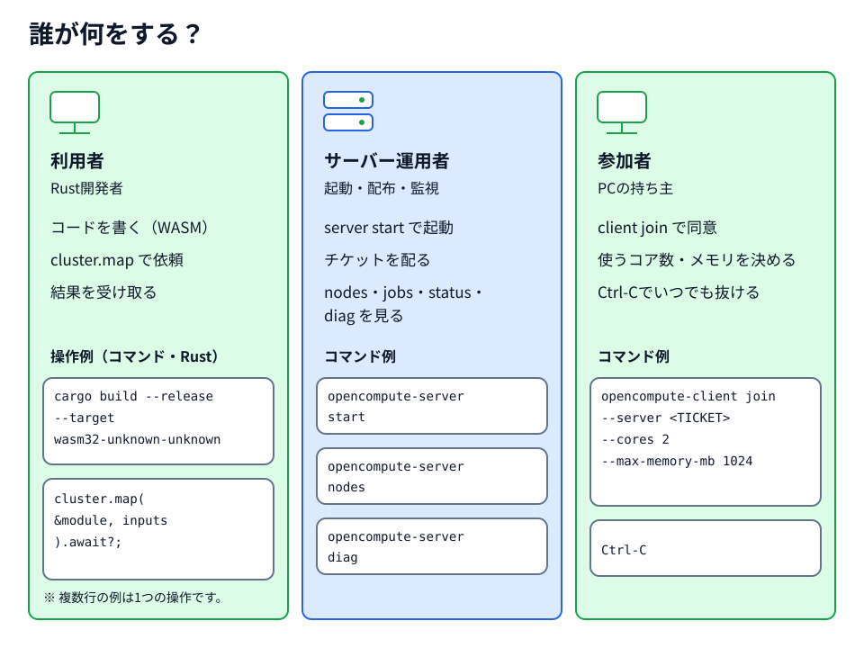
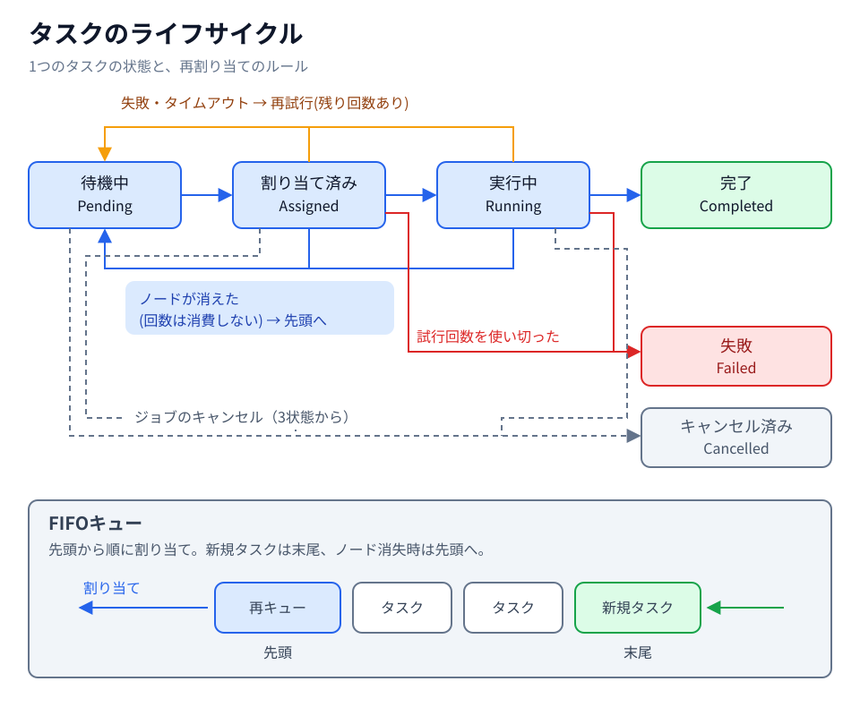
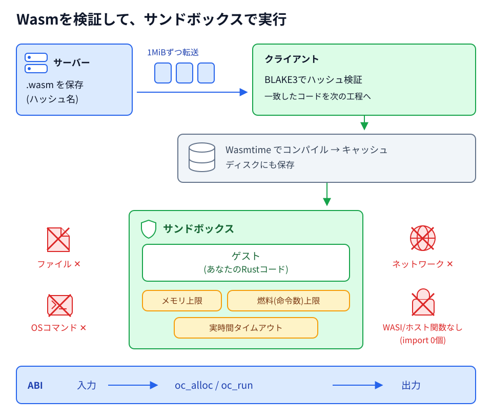
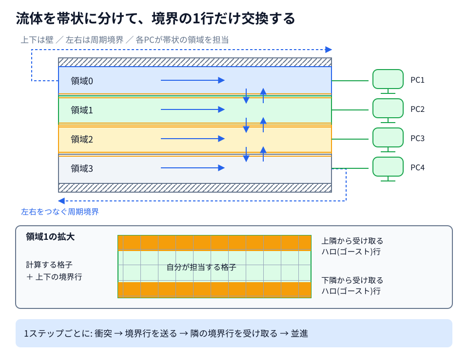
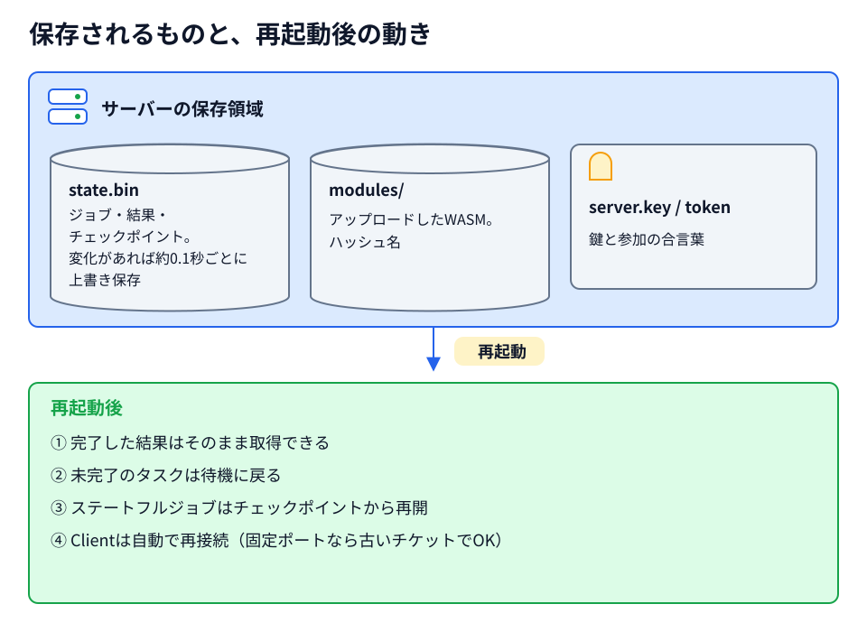

# 03 用語と基本の考え方

この章は、ほかの文書に出てくる言葉を先にそろえるための用語集です。上から順に読むと、仕組みの全体像がつかめます。

## 登場する役

| 言葉 | 意味 |
|---|---|
| サーバー | 仕事を受け付け、タスクに分けてクライアントに配り、結果を集めるプログラム(`opencompute-server`)。 |
| クライアント | 自分の PC の CPU を貸して、タスクを実行するプログラム(`opencompute-client`)。「ワーカー」「ノード」とも呼びます。 |
| 利用者 | 計算を頼む人。Rust のコードから `Cluster` を使います。 |
| ノード | サーバーに接続しているクライアント1つ。サーバーの `nodes` コマンドの1行がノード1つに当たります。 |

## 仕事の単位

| 言葉 | 意味 |
|---|---|
| ジョブ | 利用者が1回の依頼で投げる仕事のまとまり。 |
| タスク | ジョブを分けた小さな計算。入力1件につき1タスクです。実行はクライアントが担当します。 |
| 試行(attempt) | 1つのタスクを実行しようとした回数。失敗や PC の停止でやり直すたびに増えます。 |
| スロット | クライアントが同時に実行できるタスクの枠。`--max-tasks` と `--cores` の小さいほうで決まります。 |
| FIFO キュー | 先に入ったタスクから先に割り当てる待ち行列。やり直すタスクは先頭に戻ります。 |

タスクは次のように状態を移ります。

## 接続と信頼

| 言葉 | 意味 |
|---|---|
| iroh | 通信に使っている Rust のライブラリ。QUIC という暗号化された通信の上で、公開鍵を相手の「住所」として使います。 |
| 公開鍵・秘密鍵 | サーバーとクライアントは、それぞれ鍵のペアを持ちます。公開鍵が ID(ノード ID)になり、接続のたびに相手の鍵を確かめます(相互認証)。 |
| チケット | サーバーの公開鍵、アドレス、参加用トークンを1本の文字列(`oc1...`)にしたもの。これを受け取ると、サーバーに接続して参加を申し込めます。 |
| トークン | 参加を許可するための合言葉。チケットに入っていて、サーバーの `token` ファイルにも保存されます。 |
| ハートビート | クライアントが数秒ごとに送る「生きています」という知らせ。途切れると、サーバーはそのクライアントが消えたと判断します。 |

## 計算の中身

| 言葉 | 意味 |
|---|---|
| 組み込み計算(builtin) | `prime_count`、`sleep_square`、`echo` のように、クライアントにあらかじめ入っている計算。 |
| WASM モジュール | 利用者が Rust などで書いて WebAssembly にコンパイルした計算。サーバーにアップロードすると、クライアントに配られます。 |
| サンドボックス | 計算がファイル、ネットワーク、OS のコマンドに触れないように囲った実行環境。WASM の実行には Wasmtime を使います。 |
| 燃料(fuel) | WASM が実行できる命令数の上限。使い切ると計算は止まります。 |
| ハッシュ | 中身から計算した短い指紋。WASM の配布では、受け取った中身が改ざんされていないかの確認に使います。 |

## ステップを繰り返す計算

| 言葉 | 意味 |
|---|---|
| ステートフルジョブ | 時間を1ステップずつ進めながら、各担当が自分の状態を持ち続ける計算。流体シミュレーションが例です。 |
| 領域(part) | 計算する空間を分けた1つの担当部分。ここでは帯(strip)状に分けます。 |
| ハロ(halo) | 隣の領域との境界にある1行。次のステップの計算に隣の値が要るので、毎ステップ交換します。 |
| リレーモード | 境界のデータをサーバー経由で交換する方式(既定)。 |
| 直接モード(`--direct`) | 隣の領域を持つクライアントどうしが直接境界を交換する方式。 |
| チェックポイント | 一定のステップごとにサーバーに保存する途中経過。 |
| ロールバック | 参加者の離脱や停止が起きたとき、直近のチェックポイントまで戻してやり直すこと。 |
| エポック(epoch) | ロールバックのたびに増える番号。古いエポックのメッセージは無視します。 |
| 再分割 | 参加者の増減に合わせて、チェックポイントから領域の切り方を変えること。 |

## 保存されるもの

サーバーは、データフォルダに次のものを置きます。

| ファイル | 内容 |
|---|---|
| `server.key` | サーバーの秘密鍵。 |
| `token` | 参加用トークン。 |
| `state.bin` | ジョブ、結果、チェックポイント。 |
| `modules/` | アップロードされた WASM。ファイル名はハッシュです。 |
| `control.sock` | CLI やライブラリが使う制御用のソケット(Unix ドメインソケット、権限 0600)。 |

## 通信の約束

細かい仕様は [PROTOCOL.md](PROTOCOL.md) にあります。要点は次のとおりです。

- サーバーとクライアントは、1本の双方向ストリームでメッセージを往復します。
- 1つのメッセージは、4バイトの長さのあとに postcard 形式のデータが続く形です。
- 参加前のメッセージは 4 MiB まで、参加後は 256 MiB までです。タスクの入出力は 2 MiB まで、WASM は 32 MiB までです。
- プロトコルのバージョンは 3 です。違うバージョンどうしは接続できません。
