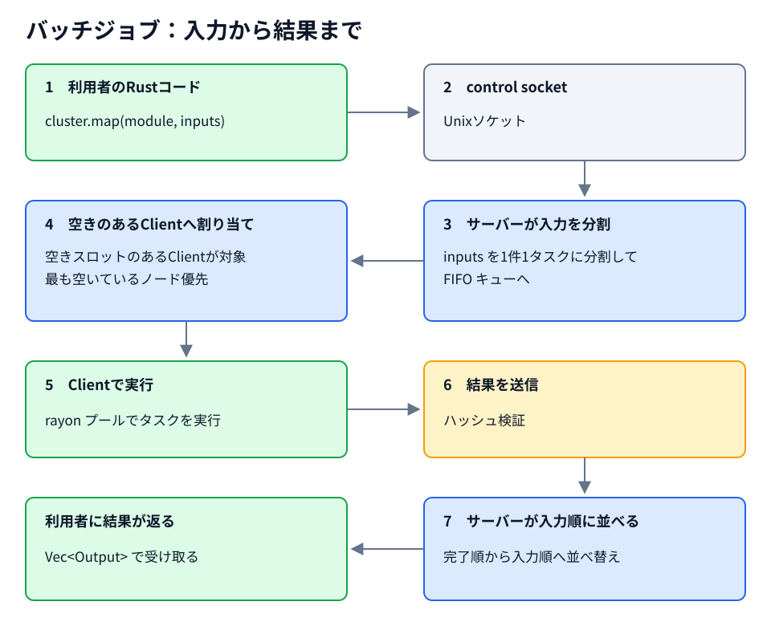
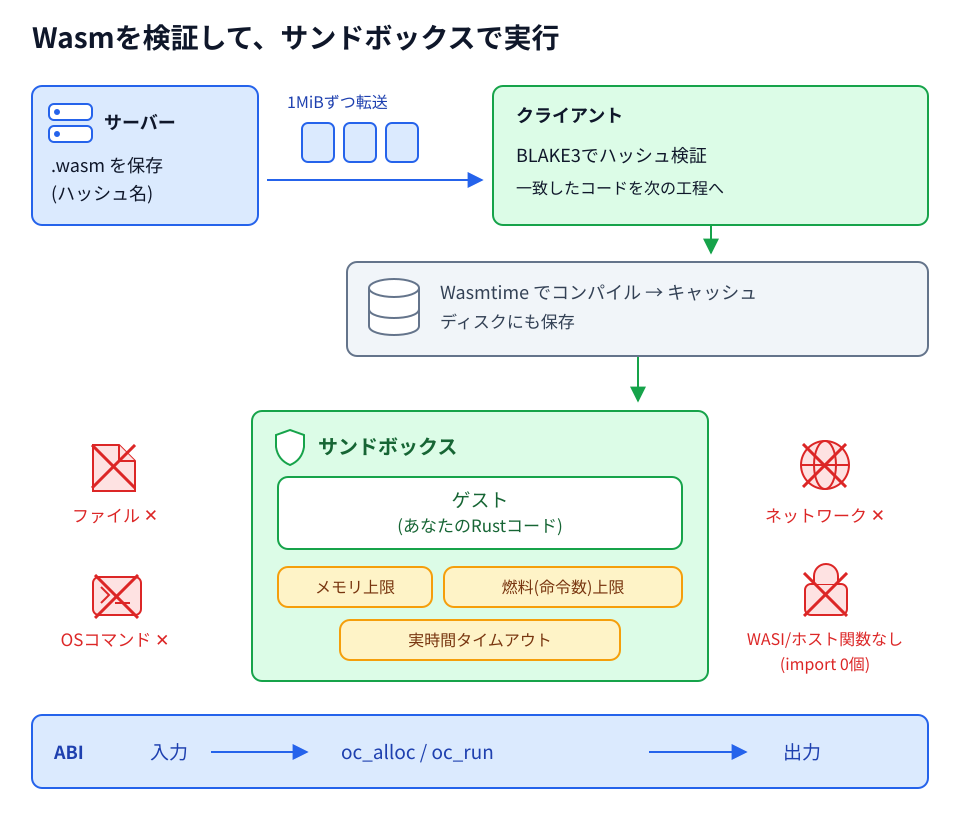

# 04 計算モジュールを書く

自分の計算を分散するには、Rust で関数を1つ書いて WASM にコンパイルし、サーバーにアップロードします。この章は、例の `fibonacci` を使って手順を説明します。

## 流れ

1. 入力を受け取って出力を返す関数を、`opencompute-guest` のマクロで公開する。
2. `wasm32-unknown-unknown` 向けにビルドする。
3. 利用者側のプログラムで `Cluster` に接続し、モジュールを読み込んで、入力のリストを渡す。
4. 入力と同じ順序で、結果が返ってくる。



## 1. モジュールを書く

`examples/wasm-modules/fibonacci/src/lib.rs` が実物です。入力は postcard 形式の `u64` で、出力はフィボナッチ数(2^64 で割った余り)です。

```rust
fn run(input: &[u8]) -> Vec<u8> {
    let n: u64 = postcard::from_bytes(input).expect("input must be a postcard u64");
    let (mut a, mut b) = (0u64, 1u64);
    for _ in 0..n {
        let next = a.wrapping_add(b);
        a = b;
        b = next;
    }
    postcard::to_stdvec(&a).expect("encode")
}
opencompute_guest::export_task!(run);
```

`export_task!` は、サーバーが呼び出すための入口(`memory`、`oc_alloc`、`oc_run`)を自動で作ります。自分で書くのは、バイト列を受け取ってバイト列を返す関数だけです。

## 2. ビルドする

```bash
cd examples/wasm-modules
cargo build --release --target wasm32-unknown-unknown
```

`target/wasm32-unknown-unknown/release/fibonacci.wasm` ができます。

## 3. 利用者側から呼ぶ

`crates/compute-api/examples/fibonacci.rs` が実物です。

```rust
use opencompute::Cluster;

#[tokio::main]
async fn main() -> Result<(), opencompute::Error> {
    let cluster = Cluster::connect_default().await?;
    let module = cluster
        .load_module("examples/wasm-modules/target/wasm32-unknown-unknown/release/fibonacci.wasm")
        .await?;
    let inputs: Vec<u64> = (1..=10).map(|i| i * 10_000_000).collect();
    let results: Vec<u64> = cluster.map(&module, inputs.clone()).await?;
    for (n, r) in inputs.iter().zip(&results) {
        println!("fib({n}) mod 2^64 = {r}");
    }
    Ok(())
}
```

`connect_default` は、同じマシンで動いているサーバーの制御用ソケットにつなぎます。サーバーを `--local-worker-cores 2` 付きで起動すると、クライアントなしでもサーバー自身が計算します。

```bash
cargo run --release -p opencompute-server -- start --local-worker-cores 2   # ターミナル1
cargo run --release -p opencompute-compute-api --example fibonacci         # ターミナル2
```

## ゲストが守る制約

WASM モジュールは、次の制約のもとで動きます。

- `import` を1つも持てません。ファイル、ネットワーク、時計、OS のコマンドにも触れません。
- 使えるメモリ、命令数(燃料)、実時間には上限があります。超えるとタスクは失敗し、再試行の対象になります。
- 入力と出力は、それぞれ 2 MiB までです。
- モジュール本体は 32 MiB までです。
- 同じ入力から同じ出力が出る、決定的な関数にしてください。タスクがやり直されることがあるためです。



## 結果の取り方

- `cluster.map(&module, inputs)` は、全タスクの完了を待って、入力と同じ順序で結果を返します。
- 完了を待たずに投げたいときは、`submit_raw` でジョブ ID を受け取り、`wait_raw` で待ちます。
- ジョブの一覧や状態は、`jobs`、`status`、`nodes` で見られます。
- `cancel` でジョブを取り消せます。

## 注意

WASM の実行は、入力の検証、サイズ上限、ハッシュ確認と組み合わせて安全を保っています。ただし、悪意のある計算結果(間違った答えを返すクライアント)を見つける仕組みは未実装です。結果が重要なときは、同じタスクを別々の PC で実行して比較するなど、利用者側で確かめてください。
