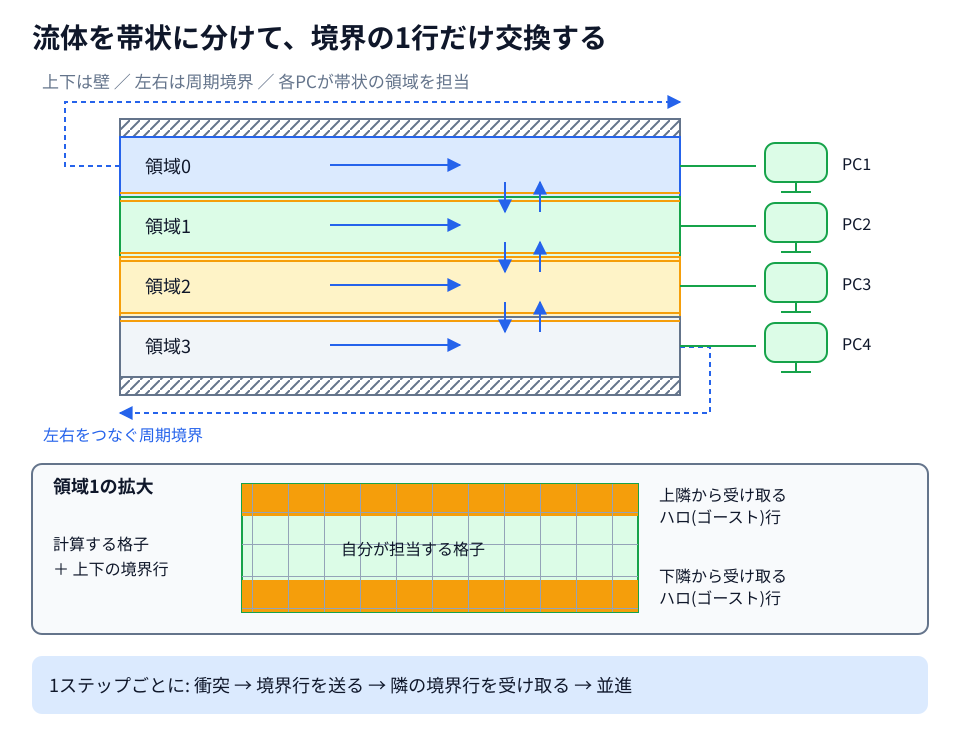
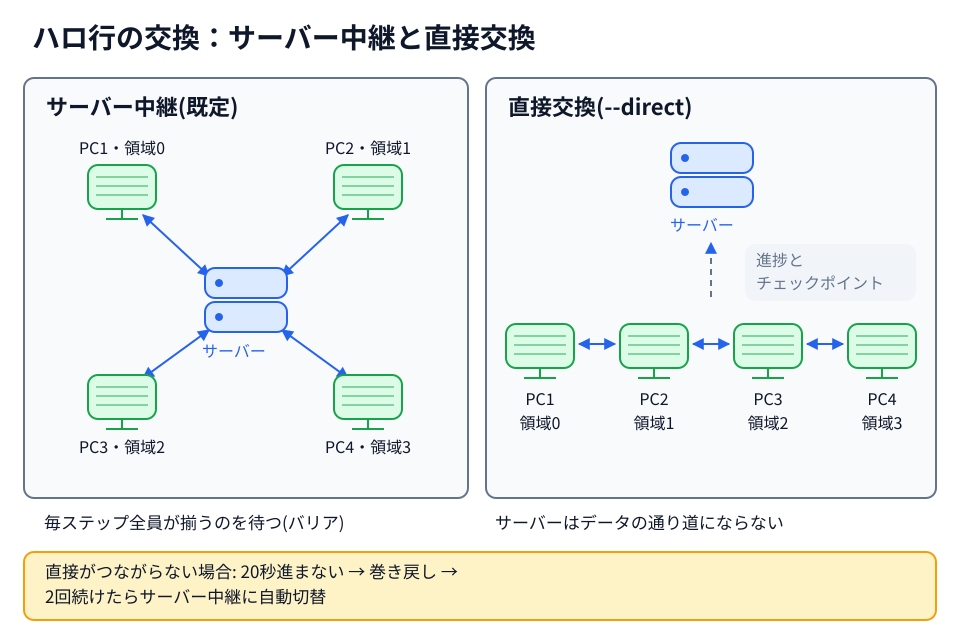
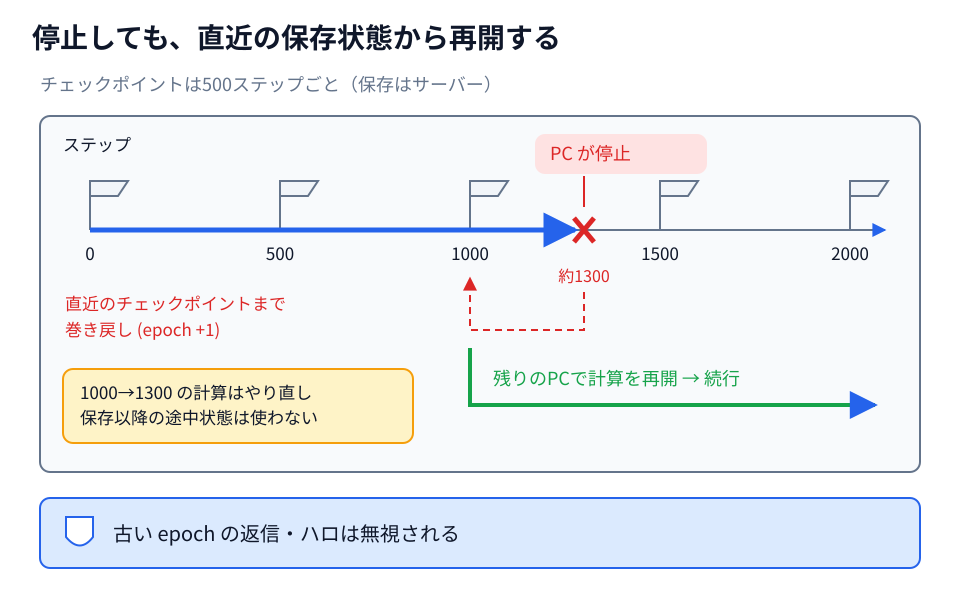
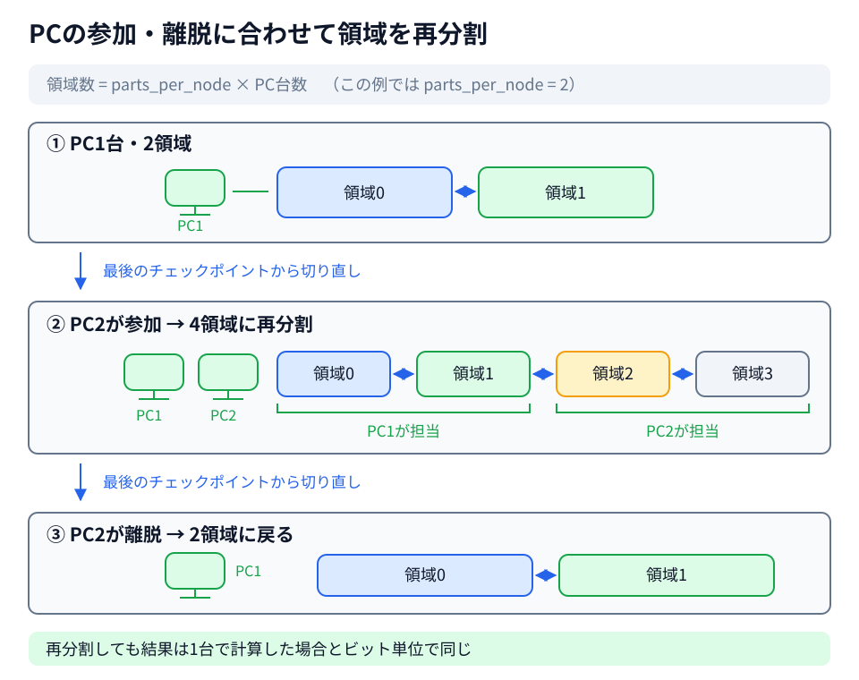

# 05 繰り返し計算と流体シミュレーション

バッチ計算のタスクは、お互いに独立しています。これに対して、流体シミュレーションのように、時間を1ステップずつ進める計算では、隣り合う担当が毎ステップ境界のデータを交換する必要があります。この章は、OpenCompute がこの種類の計算(ステートフルジョブ)をどう分散するかを説明します。

## 例: チャネル流れ

実装している計算は、2次元の格子ボルツマン法(D2Q9, BGK 衝突)です。左右の端は周期境界、上下は壁(ハーフウェイ・バウンスバック)の水路に、一定の力をかけて流します。上下の壁のあいだの速度分布は放物線になります(ポアズイユ流)。テストで理論値との一致を確かめています。

## 領域を帯に分ける

水路を横方向の帯に分けて、帯ごとに1台のクライアントが計算します。帯の上下の端には、隣の帯の境界の1行を写した「ハロ行」を持ちます。



1ステップごとの手順は、次の4つです。

1. 自分の帯の格子で衝突の計算をする。
2. 境界の行を、隣の帯に送る。
3. 隣の帯の境界の行を受け取り、ハロ行に入れる。
4. 並進(分布を隣の格子へ動かす)の計算をする。

この分け方でも、計算結果は1つのプロセスで計算した場合とビット単位で一致します(テストで確認済み)。

## 境界をどう交換するか

境界の交換には2つの方式があります。



- リレーモード(既定)は、サーバーが毎ステップ全員のデータを集めてから配ります。全員が揃うのを待つ、バリアの形です。設定は簡単ですが、すべてのデータがサーバーを通ります。
- 直接モード(`--direct`)は、隣の帯を持つクライアントどうしが直接交換します。サーバーは進捗とチェックポイントを受け取るだけです。

直接通信がつながらないときは、自動でリレーモードに切り替わります。20秒(`stall_timeout` の既定値)進まなければ巻き戻し、2回続けて詰まるとリレーに切り替えます。

直接モードの効果は、1台のマシンのループバック上では小さく出ました。ネットワークをまたぐ環境では未測定です。

## 止まっても続ける: チェックポイントと巻き戻し

サーバーは、一定のステップごと(`--checkpoint-every`、既定は 500)に、全領域の状態をチェックポイントとして保存します。クライアントが止まったり抜けたりすると、全領域を直近のチェックポイントまで戻して、新しいエポックでやり直します。



古いエポックの返信やハロは、無視されます。これで、巻き戻す前の中途半端なデータが混ざることを防ぎます。巻き戻した分の計算はやり直しになります。

## 参加者が増減したら: 再分割

`--parts-per-node N` を付けると、領域の数を「N × クライアント数」に保ちます。クライアントが参加または離脱したら、直近のチェックポイントから領域を切り直します。



再分割をしても、結果は1台で計算した場合とビット単位で同じです(テストで確認済み)。

## 実行例

```bash
# リレーモード
opencompute-server submit lbm --nx 64 --ny 64 --parts 4 --steps 4000 --checkpoint-every 500

# 直接モード + 再分割
opencompute-server submit lbm --nx 64 --ny 64 --parts 2 --parts-per-node 2 --steps 30000 --checkpoint-every 500 --direct
```

自動で確かめるスクリプトは次のとおりです。

| スクリプト | 確かめること |
|---|---|
| `scripts/demo-lbm-failure.sh` | 計算中にクライアントを止めても、結果が変わらない |
| `scripts/demo-direct.sh` | 直接モードで止めても結果が変わらない。参加に合わせて再分割する |
| `scripts/demo-restart.sh` | サーバーを再起動しても、チェックポイントから再開する |
| `scripts/bench-lbm.sh` | 1台と複数台、リレーと直接の所要時間の比較 |

## できないこと

- 計算できるのは D2Q9 のチャネル流れだけです。別のステートフルな計算を足すには、`Kernel` を実装します(内部構造は [08 内部構造](08-architecture.md) の「Stateful job」を参照)。
- 1つの領域は、300万格子までです。
- サーバー自身のワーカー(`--local-worker-cores`)には、直接モードの領域を割り当てません。
- 動作確認と測定は、すべて1台のマシン上です。
