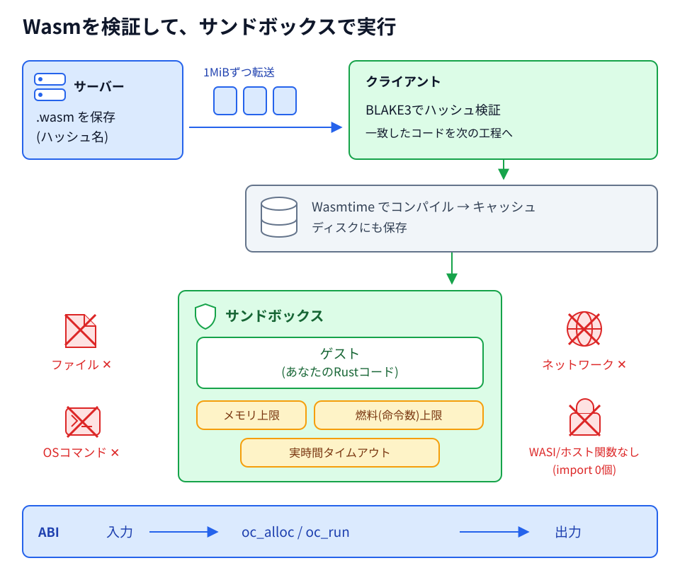
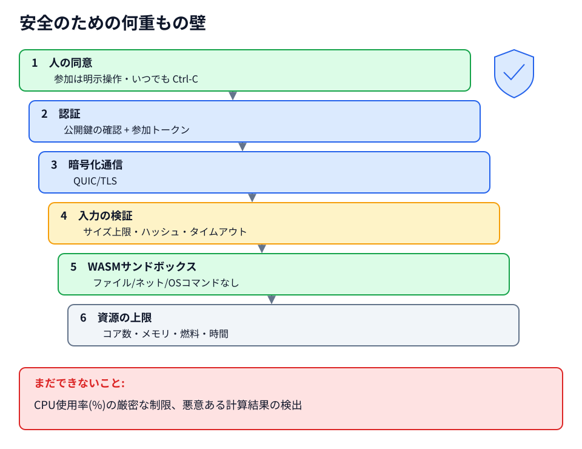

# 06 安全性と参加者のための説明

この章は、自分の PC を計算に貸す人が、何が起きて何が起きないかを知るためのものです。実装の側から見た安全設計の説明も兼ねています。

## 参加すると何が起きるか

- あなたの PC が、サーバーから渡された計算(タスク)を実行します。
- 使うのは CPU とメモリです。使う量の上限は、参加するときにあなたが決めます(`--cores`、`--max-tasks`、`--max-memory-mb`)。
- サーバーには、PC の名前、使えるコア数とメモリ、実行したタスクの結果が送られます。ファイルの中身は送られません。
- 参加は Ctrl-C でいつでもやめられます。

## 何が起きないか

WASM モジュールは、サンドボックスの中で動きます。

- ファイルを読み書きできません。
- ネットワークにつなげません。
- OS のコマンドを実行できません。
- ホスト側の関数を一切呼べません(`import` が0個のモジュールだけを受け付けます)。

つまり、他人が書いた計算が、あなたのファイルやネットワークに触れる経路はありません。

## 守りの重ね方

1. 同意。参加は、あなたが `join` を実行して確認に答えたときだけです。
2. 認証。サーバーの公開鍵を確かめ、トークンが合うクライアントだけを受け入れます。
3. 暗号化。通信は QUIC(TLS)で暗号化されます。
4. 入力の検証。メッセージの大きさ、モジュールのハッシュ、タスクの時間を検査します。
5. サンドボックス。WASM は Wasmtime の中で動きます。
6. 資源の上限。コア数、メモリ、燃料(命令数)、実時間に上限があります。

## 注意が要る点

次のことは、現時点で保証していません。

- CPU 使用率(%)の厳密な制限はありません。制限できるのは並列数(コア数)とメモリです。
- 悪意のあるクライアントが、間違った結果を返したことを見つける仕組みはありません。
- サーバーの運用者は、チケットを知っている人に参加を許すことになります。チケットは信頼できる相手にだけ渡してください。
- 検証は1台のマシン上の通信で行いました。インターネット越しの運用での安全性は、別途確認してください。
- 外部のリレーサーバー(`--relay`)を使うと、その運営者のサーバーに接続情報が渡ります。ローカルでの試用には使いません。

## 参加者のチェックリスト

- チケットを渡してきた人を知っているか。
- 使うコア数とメモリは、自分の作業の邪魔にならない量か。
- 参加する時間と、抜けるときの方法(Ctrl-C)を決めたか。
