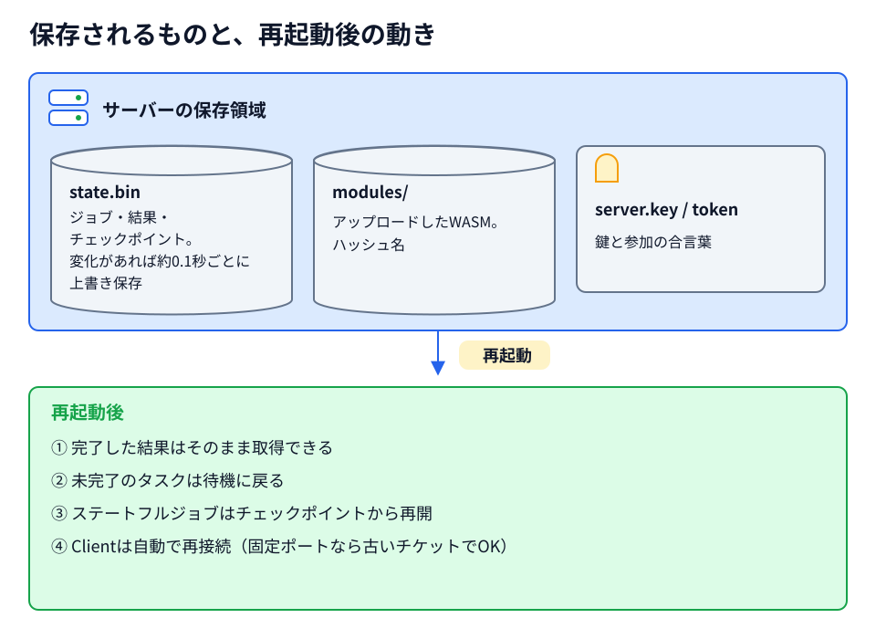

# 07 運用とトラブルシューティング

サーバーを動かし続ける人に向けた説明です。

## サーバーが保存するもの

データフォルダ(`--data-dir`、既定は `opencompute-server-data`)に、次のものを保存します。

- `state.bin`: ジョブ、結果、チェックポイント。状態が変わると、約0.1秒おきを上限に、一時ファイルに書いてから置き換えます。
- `modules/<ハッシュ>.wasm`: アップロードされたモジュール。
- `server.key`: 秘密鍵。これを消すと、サーバーの身元が変わり、チケットが使えなくなります。
- `token`: 参加用の合言葉。
- `control.sock`: 制御用ソケット。同じマシンのユーザーだけが使えます(権限 0600)。

## 再起動したとき

- 完了した結果は、そのまま取得できます。
- 実行中だったタスクは、待機に戻ります。
- ステートフルジョブは、チェックポイントから再開します。
- クライアントは、自動で再接続します。サーバーを `--bind` で固定したアドレスで動かしていれば、古いチケットのまま接続できます。アドレスが変わるときは、新しいチケットを配り直します。

`scripts/demo-restart.sh` が、この動きを自動で確かめます。

## 状況を見る

| コマンド | 内容 |
|---|---|
| `info` | サーバーの ID とチケット |
| `nodes` | 参加中のクライアントの一覧 |
| `jobs` | ジョブの一覧 |
| `status <ID>` | 1つのジョブとそのタスク |
| `diag` | 稼働時間、失ったノード数、ロールバック回数、保存回数、復元したジョブ数、中継したハロ数 |
| `cancel <ID>` | ジョブの取り消し |

ログの量は、環境変数 `RUST_LOG` で調整します(例: `RUST_LOG=info`)。

## よくある問題

### クライアントが参加できない

- チケットが古い。サーバーを別のアドレスで起動し直した場合は、`info` で新しいチケットを確かめます。
- トークンが違う。`JoinRejected` が表示されます。
- プロトコルのバージョンが違う。サーバーとクライアントを、同じ版でビルドし直します。
- 別々のマシン間では、UDP が通る必要があります。この構成は未検証です。

### タスクがなかなか終わらない

- `nodes` で、割り当て済みと完了の数が動いているか見ます。
- ハートビートが途切れたクライアントは、`--heartbeat-timeout-secs`(既定 6 秒)のあとに消えたと判断されます。
- 失敗が続くと、タスクは試行回数を使い切って失敗します。`status` で確認します。

### 流体シミュレーションが進まない

- 直接モードでつながらないときは、20秒たつと巻き戻しが起き、2回続けるとリレーに切り替わります。`diag` の `rollbacks` で回数が分かります。
- クライアントが1つもないと、ジョブは待機します。

### メモリが足りない

- 1つの領域は、300万格子までです。
- クライアントの `--max-memory-mb` を、タスクのサイズに見合う値にします。

## 容量の注意

ジョブと結果は、サーバーが自動で消しません。長く運用するときは、`state.bin` の大きさに気をつけてください。

## 制限値

主な値は [08 内部構造](08-architecture.md) の「制限値一覧」にあります。
