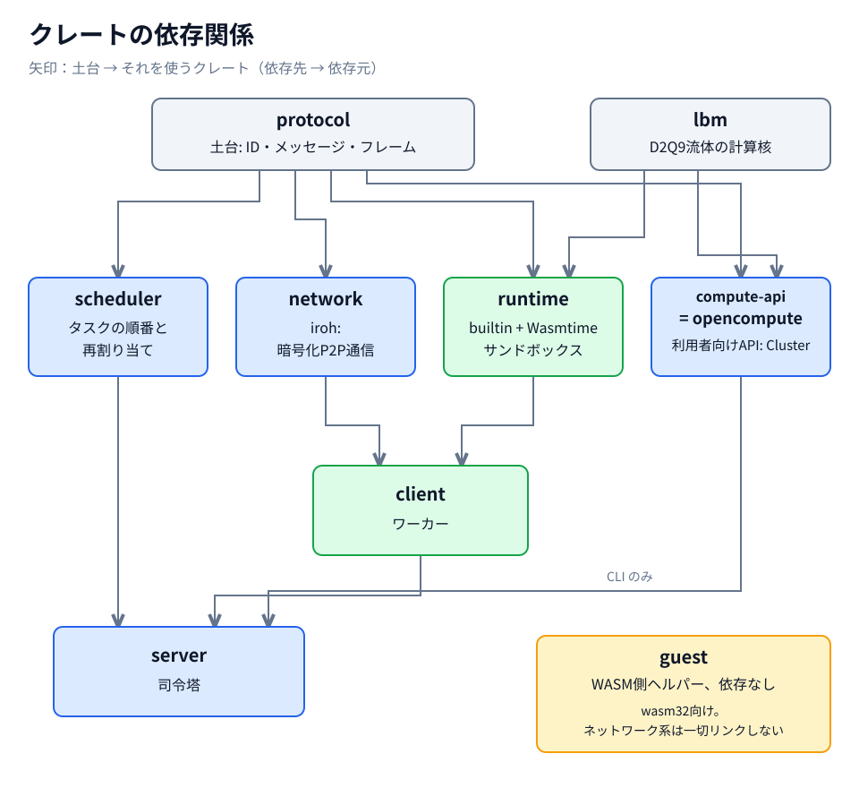
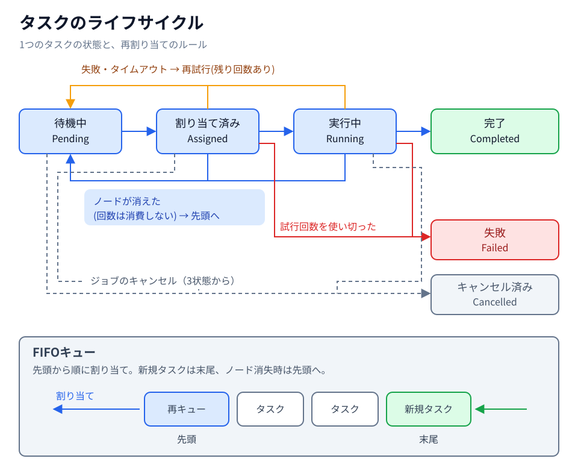
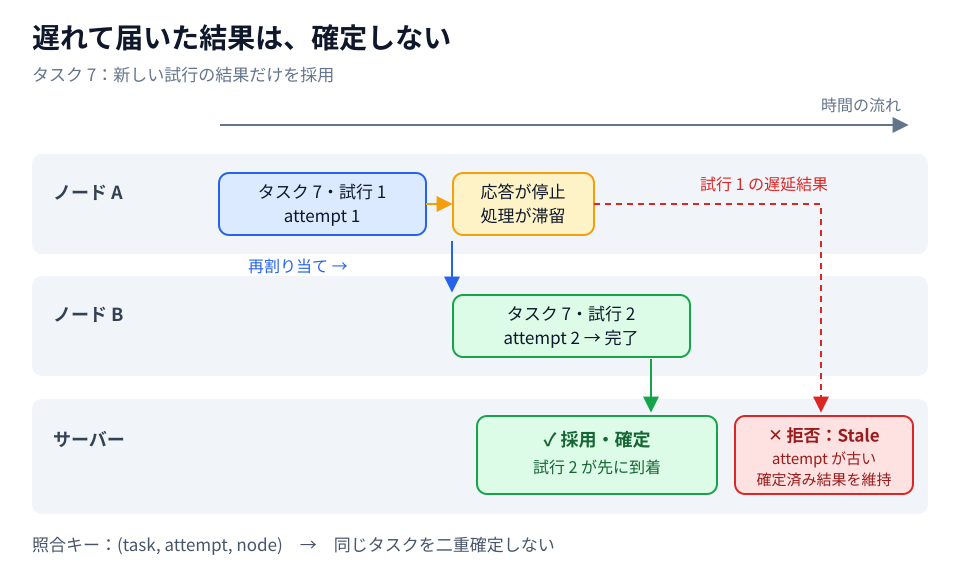
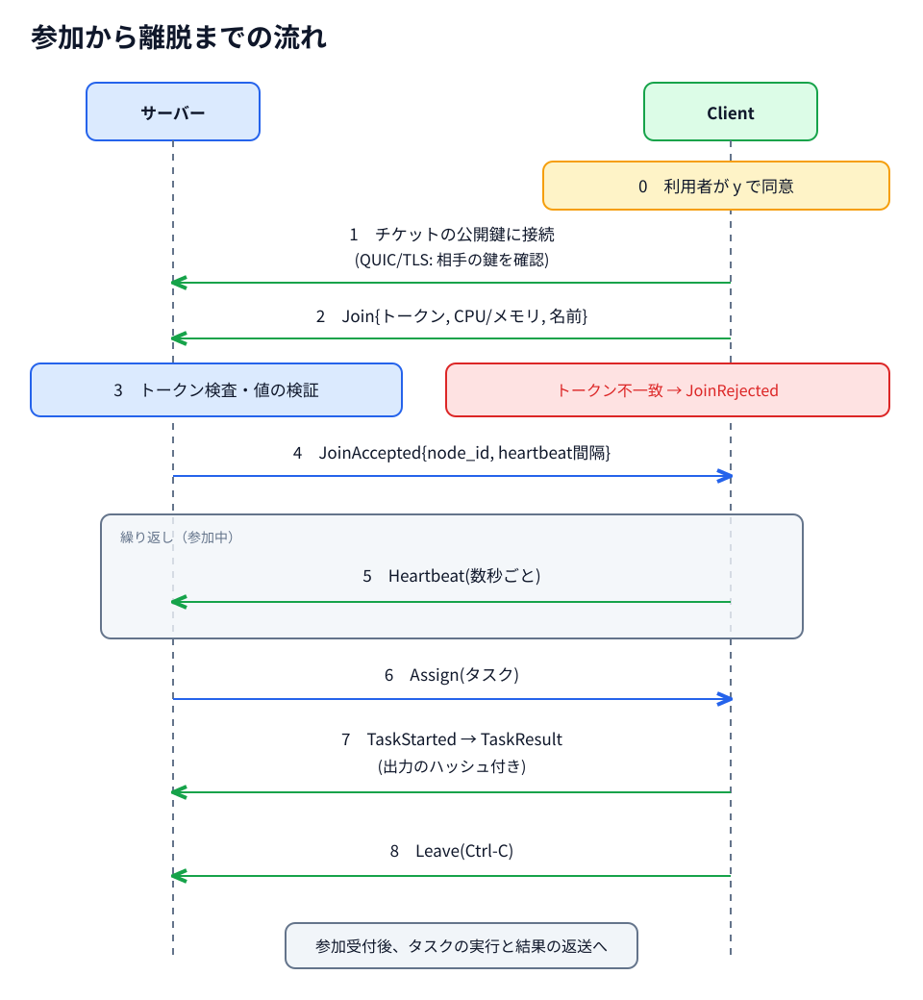
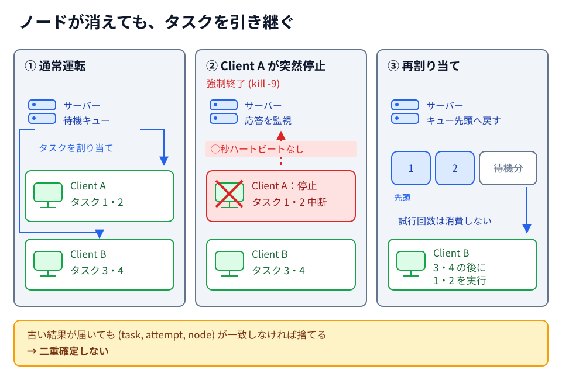
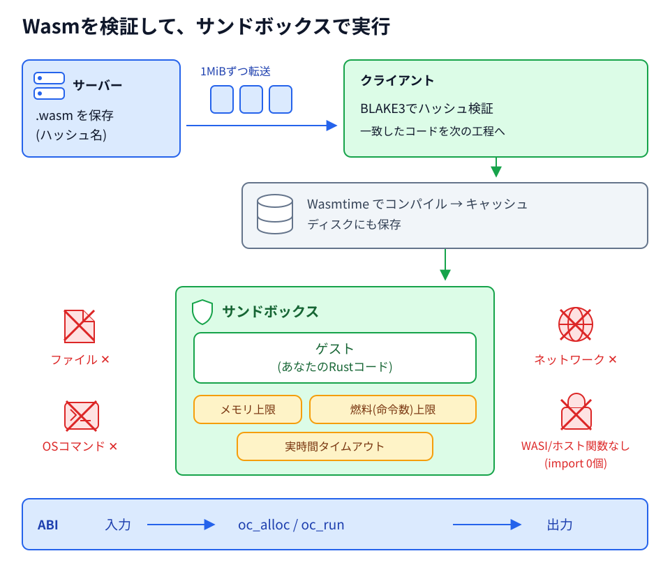
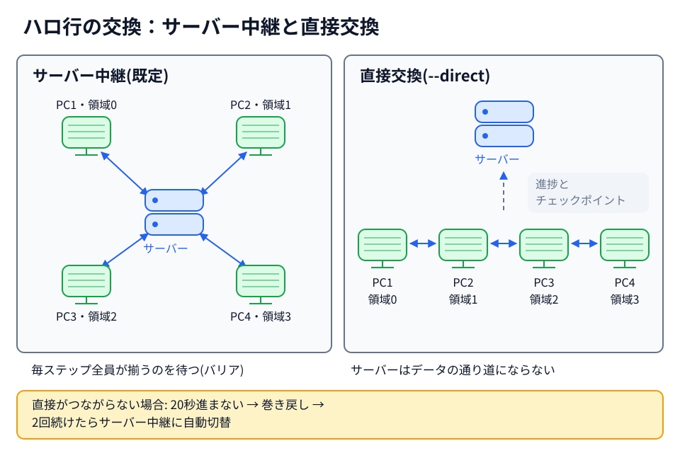
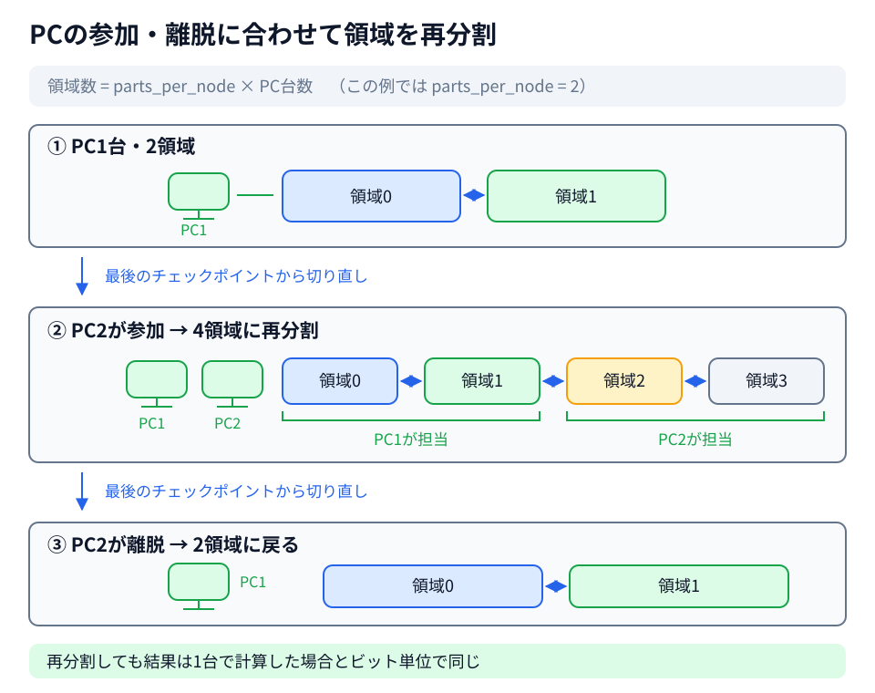
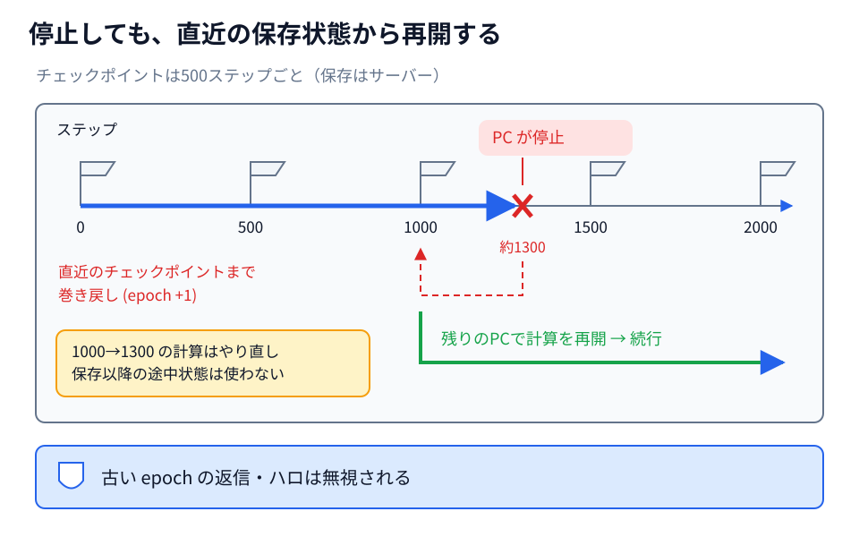
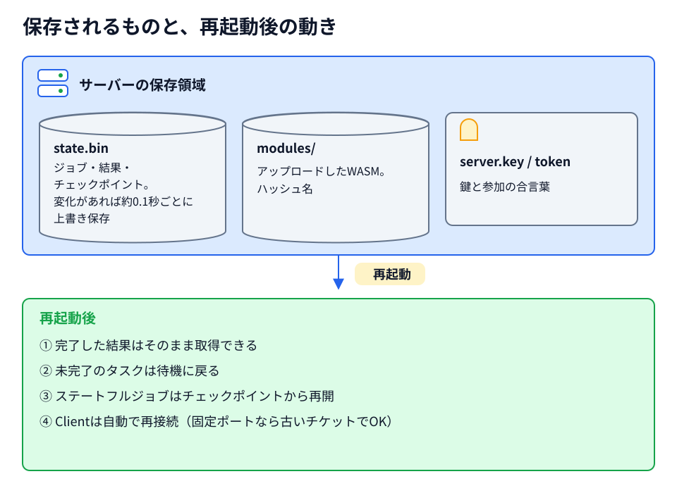

# OpenCompute アーキテクチャ

本書は、ソースコードを読む人・直す人に向けた内部構造の説明です。全体の説明は [01 OpenCompute とは](01-overview.md)、言葉の意味は [03 用語と基本の考え方](03-concepts.md) にあります。記述は `crates/` 配下の実装に基づいています。通信メッセージの細部は [PROTOCOL.md](PROTOCOL.md) を見てください。

ワイヤプロトコルは **v3**（`PROTOCOL_VERSION = 3`、サーバ↔クライアントの ALPN は `opencompute/3`、クライアント↔クライアントは `opencompute-peer/1`）。v2 の記述（relay 専用・固定 parts 数など）は本版で置き換わっている。

---

## 1. 全体像

OpenCompute は「1 台のサーバ（コーディネータ）＋任意台数のクライアント（ワーカー）」で構成される。

- **server**: 参加受付、タスクのスケジューリング、結果の検証・確定、モジュール配布、ノード死活監視、stateful job の調停（バリア／直接交換の進捗監視・ストール監視・再分割）、`state.bin` への永続化、ローカル制御ソケット。
- **client**: サーバへ参加、ハートビート、タスク実行（built-in 関数または Wasmtime サンドボックス）、モジュール取得、stateful part の保持、切断時の指数バックオフ再接続。direct モードではピア用 iroh エンドポイント（`opencompute-peer/1`）と part actor を持ち、隣接 part と直接ハローを交換する。
- **control クライアント**: `opencompute-server` CLI と `opencompute` facade（`Cluster`）が Unix ソケット経由でサーバを操作する。facade はネットワークスタックをリンクしない。

### 1.1 コンポーネント図

```text
┌────────────────────────────── 利用者 / 管理 ──────────────────────────────┐
│ opencompute-server CLI (Info / Nodes / Jobs / Status / Cancel / Submit …)  │
│ opencompute facade  (Cluster::connect → map / map_with / run_lbm …)        │
└───────────────────────────────────┬────────────────────────────────────────┘
                                    │ Unix socket: <data-dir>/control.sock (0600)
                                    │ ControlRequest / ControlResponse
┌───────────────────────────────────▼────────────────────────────────────────┐
│ opencompute-server プロセス（コーディネータ）                               │
│                                                                            │
│  control listener ── handle() ───────────────┐                             │
│                                              │                             │
│  iroh endpoint (ALPN "opencompute/3")        ▼                             │
│   │ accept_worker                 ┌───────────────────────────┐            │
│   ├──────────────► serve_stream ─►│ std::sync::Mutex<Inner>   │            │
│   │                  │ reader      │  ├ Scheduler              │            │
│   │                  │ writer ◄────┤  ├ conns: NodeId→mpsc     │            │
│   │                  └─────────────┤  ├ modules: Hash→bytes    │            │
│   │                                │  ├ stateful: JobId→SJob   │            │
│   │                                │  ├ peer_addrs: NodeId→vec │            │
│   │                                │  └ counters / metadata    │            │
│   │                                └───────────┬───────────────┘            │
│   │                                            │                            │
│   └── dispatcher task (100 ms tick / Notify) ──┘                            │
│         expire → schedule → s_tick（stall 監視・再分割）→ maybe_save        │
│                                                                            │
│  optional local worker: run_session ⇄ tokio::io::duplex(1 MiB), local=true  │
└────────────────────────────────────────────────────────────────────────────┘
              ▲ QUIC/TLS（Ed25519 相互認証、ALPN "opencompute/3"）
              │
   ┌──────────┴───────────┐            ┌──────────────────────┐
   │ opencompute-client A │            │ opencompute-client B │  …
   │ session task         │            │                      │
   │  reader task → mpsc64│            │                      │
   │  select loop         │            │                      │
   │  rayon pool          │            │                      │
   │   └ Executor         │            │                      │
   │      ├ builtin       │            │                      │
   │      └ Wasmtime      │            │                      │
   │        + module cache│            │                      │
   │  PeerNet             │            │                      │
   │   ├ mailbox          │            │                      │
   │   ├ links: NodeId→tx │            │                      │
   │   └ part actor       │            │                      │
   └──────────────────────┘            └──────────────────────┘

   クライアント同士は、サーバとは別の ALPN "opencompute-peer/1" で直接つながる
   （direct モードの stateful ハロー。best effort。到達不能ならサーバ中継へ戻る）。
```

### 1.2 コンポーネントの責務

| コンポーネント | 実体 | 責務 |
|---|---|---|
| `protocol` | ライブラリ | ID、ワーカーメッセージ、制御メッセージ、postcard フレーミングとサイズ上限 |
| `scheduler` | ライブラリ（純粋・I/O なし） | FIFO キュー、スロット管理、再試行、タイムアウト、ノード喪失時の再キュー、結果の重複排除、`PlacementPolicy` |
| `network` | ライブラリ（iroh） | QUIC エンドポイント、`Ticket`（サーバアドレス＋トークン）、鍵ファイル、ストリームの accept/dial、ピア接続（`dial_peer`、`encode_addr`/`decode_addr`） |
| `runtime` | ライブラリ | built-in 実行、Wasmtime 実行（fuel・メモリ・実時間）、モジュールキャッシュ、stateful `Kernel` と再分割（`repartition`） |
| `lbm` | ライブラリ（純粋） | D2Q9 カーネル。ストリップ分割、ハロー（境界）データ、チェックポイントからの再分割 |
| `client` | ライブラリ＋バイナリ | セッション、heartbeat、rayon 実行プール、モジュール組み立て、再接続、graceful leave、`PeerNet`（ピア通信・メールボックス）と direct モードの part actor |
| `server` | ライブラリ＋バイナリ | 接続受付、join 認証、ディスパッチ、モジュールストア、制御ソケット、永続化、stateful 調停（バリア／直接交換の監視／ストール監視／再分割） |
| `compute-api` | ライブラリ（`opencompute`） | 制御ソケット経由のユーザー API（`map`、`run_lbm`） |
| `guest` | マクロのみ（依存なし） | WASM ゲストの `oc_alloc` / `oc_run` エクスポート |

### 1.3 ワーカープロトコル

1 接続につき双方向ストリーム 1 本。メッセージは postcard を `u32` ビッグエンディアン長で区切る（`protocol/src/codec.rs`）。

| 方向 | メッセージ | 用途 |
|---|---|---|
| C→S | `Join` | 最初の 1 通。プロトコル版・トークン・名前・能力・`peer_addr`（ピア接続用アドレス、空ならピア到達不可） |
| C→S | `Capabilities` | 能力更新（**クライアントからは送られていない。未使用**） |
| C→S | `Heartbeat` | 実行中タスク `(task_id, attempt)` の一覧 |
| C→S | `TaskStarted` / `TaskResult` / `TaskFailed` | 実行開始・成功・失敗 |
| C→S | `ModuleRequest` | 未所持モジュールの要求 |
| C→S | `Leave` | 自主退出 |
| C→S | `PartBoundary` / `PartFailed` | stateful part の境界データ（**リレーモードのみ**）・失敗 |
| C→S | `PartProgress` | direct モードの part の進捗とチェックポイント用スナップショット |
| S→C | `JoinAccepted` / `JoinRejected` | join 結果 |
| S→C | `Assign` | タスク割当（入力・ハッシュ・タイムアウト・実行制限） |
| S→C | `ModuleTransfer` / `ModuleNotFound` | モジュールチャンク・不存在 |
| S→C | `CancelTask` | キャンセル通知（**実行は中断しない**） |
| S→C | `Shutdown` | サーバ停止・heartbeat タイムアウト・セッション置換 |
| S→C | `PartInit` | stateful part の生成。`direct: true` なら `peers`（全 part の配置）・`steps`・`checkpoint_every` を伴う |
| S→C | `PartStep` | リレーモードの 1 ステップ（ハロー付き） |
| S→C | `PartRelease` | part の破棄。`below_epoch` 未満の epoch のメールボックスを消す |

制御プロトコル（`protocol/src/control.rs`）は `Info`、`Nodes`、`Jobs`、`Status`、`UploadModule`、`Submit`、`Results`、`Cancel`、`SubmitStateful`、`StatefulResult`、`Diag` を提供する。

クライアント間プロトコル（`protocol/src/message.rs` の `PeerMessage`、ALPN `opencompute-peer/1`）は現在 `Halo` 1 種類だけ。`Halo{job_id, dst_part, epoch, step, side, data}` を、送信側 part から隣接 part へ送る。`side` は 0 = 受け手の lower halo、1 = 受け手の upper halo。このストリームはサーバを経由しない。

---

## 2. クレート依存グラフ



依存は下位（`protocol` / `lbm`）から上位（`server`）への一方向で、循環はない。

```text
L4                       ┌──────────┐
                         │  server  │
                         └──┬─┬─┬─┬─┘
          ┌─────────────────┘ │ │ └─────────────────┐
          ▼                   ▼ ▼                   ▼
L3  ┌──────────┐      ┌───────────┐        ┌─────────────┐
    │  client  │      │ scheduler │        │ compute-api │
    └──┬────┬──┘      └─────┬─────┘        └──┬───────┬──┘
       │    │               │                 │       │
       ▼    ▼               ▼                 ▼       ▼
L2  ┌──────────┐      ┌──────────────┐   ┌──────────────────┐
    │ network  │      │   runtime    │   │       lbm        │
    └────┬─────┘      └───┬──────┬───┘   └────────┬─────────┘
         │                │      └────────────────┘
         ▼                ▼
L1  ┌────────────────────────────────────────────────────────┐
    │                       protocol                         │
    └────────────────────────────────────────────────────────┘

    server はさらに protocol / scheduler / network / client /
    compute-api / runtime のすべてに依存する（図では省略）。
    guest は依存ゼロで、WASM ゲスト（examples/wasm-modules）だけが使う。
```

| クレート | 内部依存 |
|---|---|
| `protocol` | なし |
| `lbm` | なし（serde / postcard のみ） |
| `guest` | なし |
| `scheduler` | `protocol` |
| `network` | `protocol`（＋ iroh） |
| `runtime` | `protocol`, `lbm` |
| `compute-api` | `protocol`, `lbm` |
| `client` | `protocol`, `network`, `runtime` |
| `server` | `protocol`, `scheduler`, `network`, `client`, `compute-api`, `runtime` |

補足:

- `compute-api` は制御ソケットだけを話し、`network` / `client` には依存しない。
- `server` バイナリは CLI の `Submit` 実装のために `compute-api` を使う。`server` ライブラリ本体は制御ソケットを自前で提供する。
- `guest` はマクロ専用で、ホスト側クレートからは依存されない。
- `examples/wasm-modules` は別ワークスペース（`wasm32-unknown-unknown`）。

---

## 3. タスクライフサイクル



### 3.1 状態

`scheduler::TaskState` は 6 状態。`Completed` / `Failed` / `Cancelled` が終端。

```text
                  submit_job（入力順に queue の末尾へ）
                        │
                        ▼
                 ┌─────────────┐
      ┌─────────►│   Pending   │◄──────────────────────┐
      │          └──┬───────┬──┘                       │
      │             │       │                          │
      │  schedule   │       │ cancel_job               │ on_failed / timeout
      │ (空きスロット)│       │                          │ (failures < max_attempts)
      │             ▼       ▼                          │
      │       ┌──────────┐ ┌───────────┐               │
      │       │ Assigned │ │ Cancelled │               │
      │       └────┬─────┘ └───────────┘               │
      │            │ TaskStarted                        │
      │            ▼                                   │
      │       ┌──────────┐  on_failed                  │
      │       │ Running  │──────────────► Failed       │
      │       └────┬─────┘  (failures >= max_attempts) │
      │            │ TaskResult                         │
      │            ▼                                   │
      │       ┌───────────┐                            │
      │       │ Completed │                            │
      │       └───────────┘                            │
      │                                                │
      └── remove_node（ノード喪失。失敗予算は消費しない）
```

### 3.2 遷移表

| 現在 | イベント | 次 | 副作用 |
|---|---|---|---|
| Pending | `schedule` で空きスロットのノードに割当 | Assigned | `attempt += 1`、`assigned=(node, now+timeout_ms)`、ノードの `assigned` に追加 |
| Pending | `cancel_job` | Cancelled | `outcome=Err("cancelled")`、キューから除去 |
| Assigned | `TaskStarted`（node/attempt 一致） | Running | なし（冪等） |
| Assigned / Running | `TaskResult`（node/attempt 一致、終端でない） | Completed | `outcome=Ok(output)`、`assigned=None`、ノードの `completed += 1`、`revision += 1` |
| Assigned / Running | `TaskFailed`（一致） | Pending または Failed | `failures += 1`、`assigned=None`。`failures < max_attempts` ならキュー先頭へ、そうでなければ Failed |
| Assigned / Running | `expire` で期限超過 | Pending または Failed | 上と同じ `fail_attempt`。加えて `CancelTask` をノードへ送る |
| Assigned / Running | `remove_node`（切断・heartbeat 喪失） | Pending | キュー先頭へ、`job.retries += 1`。**`failures` は増えない**。`attempt` は保持 |
| Assigned / Running | `cancel_job` | Cancelled | 割当済みなら `(node, task, attempt)` を返し、`CancelTask` の送信対象にする |
| 終端 | 何でも | 変化なし | 報告は `Report::Stale` として無視 |

- `max_attempts` は投入時に `max(1)` に補正される。`attempt` は「これまでに割り当てた回数」で、失敗予算とは別。
- `remove_node` はノードの未完了タスクを `TaskId` 昇順で集め、逆順に `push_front` することでキュー先頭に元の順序で並べる。
- 結果の受理条件は「非終端 ∧ `attempt` 一致 ∧ 割当ノード一致」。同じ attempt の 2 通目は `Stale`。再割当後の旧 attempt も `Stale`。これが「結果の二重コミット防止」と「遅延結果の破棄」の実体。
- `JobInfo.done` は `pending == 0 && active == 0`。Failed / Cancelled も done に含まれる。

### 3.3 ディスパッチ

- キューは `VecDeque<TaskId>`。`submit_job` は入力順に末尾へ。再キュー（失敗・タイムアウト・ノード喪失）は先頭へ。
- 割当先は `PlacementPolicy`。既定の `LeastLoaded` は「空きスロット最大、同数なら `NodeId` 昇順」で決める。
- ノードのスロット数は `min(max_concurrent_tasks, allowed_cores).max(1)`。
- `schedule(now)` は空きがある限り 1 件ずつ「キュー先頭を 1 タスク」「ポリシーでノードを 1 つ」の順に割り当てる。
- サーバの dispatcher は 100 ms ごと、または `Notify`（join、結果、投入など）で起動し、`expire → schedule → s_tick → maybe_save` を実行する。
- 割当はサーバの送信キューへ `try_send` する。キューが満杯／接続が消えていれば、そのノードを「到達不能」として削除し、タスクを再キューする。

### 3.4 実行（クライアント側）

1. `Assign` を受信。入力長が `MAX_PAYLOAD_LEN` 以下かつ BLAKE3 が `input_hash` と一致するか検証。不一致なら `TaskFailed`。
2. `TaskKind::Wasm(h)` でモジュールがメモリにもディスクキャッシュにも無ければ、割当を `(hash → Vec<TaskAssignment>)` に退避し、最初の 1 件だけ `ModuleRequest` を送る（同一ハッシュの要求は集約）。
3. モジュールが揃っていれば rayon プールへ投入し、直後に `TaskStarted` を送る。つまり `Running` は「CPU 上で開始済み」ではなく「実行プールに投入済み」を意味する。
4. 実行は `catch_unwind` で包む。パニックは `TaskFailed("task panicked")`。
5. 出力が `MAX_PAYLOAD_LEN` を超えたら `TaskFailed("output too large")`。それ以外は BLAKE3 を付けて `TaskResult`。
6. サーバは受信時に長さと BLAKE3 を再検証する。不一致なら `on_failed`（失敗予算を消費）。

クライアントはサーバ指定の `timeout_ms` を `MAX_TASK_TIMEOUT`（3600 秒）で上限クリップして実行に渡す。ただし **built-in はタイムアウト引数を無視する**（`Executor::execute` の `TaskKind::Builtin` 分岐）。WASM のみが fuel と epoch interruption で実時間を守る。

### 3.5 タイムアウトとキャンセル



- タスク期限は「割当時点の `now + timeout_ms`」。キュー待ちや転送時間も含む。
- `expire` は `now > deadline` の Assigned / Running を `fail_attempt` し、`(node, task, attempt)` を返す。サーバは該当ノードへ `CancelTask` を `try_send` する。
- `CancelTask` は**プリエンプションではない**。クライアントは `(task_id, attempt)` を「キャンセル済み」集合に入れ、モジュール待ちリストから除くだけ。実行中の WASM は自身の timeout / fuel まで、built-in は完了まで走る。完了時の結果は破棄される。
- ジョブ全体のタイムアウトは無い。`ControlRequest::Results` / facade の待ち時間だけが上限。
- `cancel_job` は未完了タスクをすべて Cancelled にし、実行中だったものだけ `CancelTask` を送る。キューの Pending は捨てる。

---

## 4. ノードライフサイクル





### 4.1 Join

```text
client                                             server
  │ dial(ticket.addr, ALPN "opencompute/3") ───────►│ accept_worker
  │                                                 │ peer = conn.remote_id()（Ed25519）
  │── Join{version, token, name, caps, peer_addr} ─►│ 10 秒 timeout、MAX_FRAME_LEN
  │                                                 │ version == 3 ?
  │                                                 │ token を定数時間比較
  │                                                 │ capabilities.validate()
  │                                                 │ peer_addr ≤ MAX_PEER_ADDR_LEN
  │◄──── JoinRejected{reason} ──────────────────────│ 失敗（その後 close）
  │                                                 │ 成功: conns.insert（旧セッションへ Shutdown）
  │                                                 │      peer_addrs.insert(node, peer_addr)
  │                                                 │      sched.add_node（旧登録を remove → 再キュー）
  │◄──── JoinAccepted{node_id, heartbeat_interval}─│
  │── Heartbeat{running} ──────────────────────────►│ last_seen = now
```

- `NodeId` は iroh の認証済み公開鍵（`EndpointId` の 32 バイト）。サーバは申告値ではなく TLS 認証結果を使う。
- `peer_addr` はクライアント自身の iroh エンドポイントアドレスを postcard で符号化したもの（`encode_addr`）。サーバは `peer_addrs: HashMap<NodeId, Vec<u8>>` に保持し、stateful の `PartInit.peers` に載せて他のクライアントへ配る。空は「ピアから到達できない」の意味で、direct モードの配置対象から外れる。長さが `MAX_PEER_ADDR_LEN`（4096）を超える join は拒否する。サーバはアドレスの内容（到達可能性）を検証しない。
- クライアントはチケット内のサーバ ID を検証するため、サーバなりすましは成立しない。トークンはチケットに含まれる共有秘密。
- サーバは join 後に `JoinAccepted` を送る。クライアントは 15 秒待ち、プロトコル版が違えば `Rejected`。
- 名前は制御文字を除去し 64 文字に切り詰める。`capabilities` は `allowed_cores` / `max_concurrent_tasks` が 1..=4096、`os` が 128 バイト以下であることだけ検証する（メモリ値は検証しない）。
- 同じ NodeId で再接続すると、旧 `Conn` は `Shutdown("replaced by a newer session")` を受け、スケジューラ上では `add_node` が旧登録を `remove_node` するため、旧セッションのタスクは再キューされる。セッションの再開（状態引き継ぎ）はしない。
- サーバ内蔵ワーカーは `tokio::io::duplex(1 MiB)` 上で同じ `run_session` を動かす。`local=true`、NodeId はサーバ自身の鍵。**内蔵ワーカーは `PeerNet` を持たない**（`Worker::new` を使う）ため `peer_addr` は空になり、direct モードの配置先にはならない。**内蔵ワーカーは切断しても再接続ループを持たない**（`run_session` が終われば警告して終了）。

### 4.2 Heartbeat と死活監視

- サーバは `ServerConfig::heartbeat_interval`（既定 2 秒）を `JoinAccepted.heartbeat_interval_ms` で通知する。CLI 起動時は `heartbeat_timeout / 3`（最低 200 ms）に上書きされる。
- クライアントは受信値を 50 ms..60 秒にクランプして ticker を作る。`MissedTickBehavior::Delay`。
- サーバの `last_seen` を更新するのは `Heartbeat`、`TaskStarted`、`TaskResult`、`TaskFailed`、`PartBoundary`、`PartProgress`。`PartFailed`、`ModuleRequest`、`Capabilities` では更新しない（実装上そうなっている）。
- 死活判定は dispatcher の `expire`。`now - last_seen > heartbeat_timeout`（既定 6 秒、厳密に大）で死亡。
- 死亡ノードには `Shutdown("heartbeat timeout")` を `try_send` し、`conns` から削除、`nodes_lost` を加算、`Scheduler::remove_node` でタスクを再キュー、stateful job はロールバックする。
- 送信キューが満杯で `Assign` を渡せない場合も同様にノードを削除する（`Shutdown("outbound queue stalled")`）。

### 4.3 喪失時のタスク処理

- 通常タスク: `remove_node` が未完了タスクを Pending に戻してキュー先頭へ。`attempt` は保持されるため、旧ノードからの遅延結果は `Stale`。失敗予算は消費しない（ノード喪失はタスクの責任ではない）。
- stateful job: そのノードに part が置かれていたジョブは、**全 part が最新の完全なチェックポイントへロールバック**する（6.7）。`parts_per_node > 0` なら残ったノード数に合わせて再分割も行う（6.5）。
- 切断（FIN/エラー）と `Leave` も同じ cleanup 経路。ただし「現在登録されているセッション番号」と一致する場合だけ削除する。古いセッションが新しいセッションの登録を消さないためのガード。
- 切断・`Leave`・heartbeat 喪失・送信失敗のいずれも `nodes_lost` カウンタを増やす（`Leave` も「喪失」として数える）。

### 4.4 再接続

クライアントの `run_client` はセッション終了理由に応じて動く。

| `SessionEnd` | 動作 |
|---|---|
| `Stopped` | `Leave` 送信済み。最大 2 秒 `conn.closed()` を待って終了 |
| `Rejected` | 再試行せず `ClientError::Rejected` を返す |
| `ServerShutdown` | 警告後、再接続へ |
| `Disconnected` | 警告後、再接続へ |

- バックオフは 1 秒から始まり、試行ごとに 2 倍、上限 30 秒。直前のセッションが 30 秒以上続いていた場合は 1 秒にリセット。
- 再接続は同じチケット（同じサーバ ID・同じトークン）へ新規 dial + 新規 `Join`。サーバ側では新セッションとして登録され、旧セッションのタスクは再キューされる。
- Ctrl-C は `watch` チャネルで stop を立て、session が `Leave` を送る。CLI は最大 5 秒待つ。
- `JoinRejected`（トークン不正・版不一致）は恒久エラーで再試行しない。

### 4.5 サーバ停止

`ServerHandle::shutdown` は、全接続へ `Shutdown("server stopping")` を `try_send` → stop フラグ → `save_now`（同期）→ 200 ms 待機 → 全タスク abort → エンドポイント close → `control.sock` 削除、の順。

---

## 5. モジュール転送



### 5.1 アップロード

1. `ControlRequest::UploadModule(bytes)`。空または `MAX_MODULE_LEN`（32 MiB）超は拒否。
2. サーバが BLAKE3 を計算し、`<data-dir>/modules/<hash>.wasm` に一時ファイル＋rename で保存。
3. 同時にメモリ上の `modules: HashMap<ModuleHash, Arc<Vec<u8>>>` に格納。
4. `TaskKind::Wasm(hash)` のジョブ投入時、サーバはメモリ上のモジュール存在を確認する。無ければ投入を拒否する（`module <hash> not uploaded`）。
5. サーバ起動時、`modules/` の全ファイルを読み、サイズ ≤ 32 MiB かつ「ファイル名 == BLAKE3」のものだけをメモリへ復元する。ハッシュ不一致ファイルは警告して無視する。

### 5.2 配布

```text
client                                             server
  │◄──── Assign{kind: Wasm(h), input, …} ──────────│ dispatcher
  │ executor に h が無い（メモリ・ディスクキャッシュ両方）
  │── ModuleRequest{h} ───────────────────────────►│ modules.get(h)
  │                                                │  ├ None → ModuleNotFound
  │                                                │  └ Some(bytes): 1 MiB ずつ
  │◄──── ModuleTransfer{h, total_len, off=0, …} ───│
  │◄──── ModuleTransfer{…, off=1 MiB, …} ──────────│
  │  …                                             │
  │  offset 連続性・total 一致・chunk ≤ 1 MiB を検証 │
  │  BLAKE3 一致・import 無し・コンパイル成功を確認   │
  │  ディスクキャッシュへ保存（再検証可能な形で）      │
  │── TaskStarted（待機していた全タスク分） ────────►│
```

- チャンクは `MODULE_CHUNK_LEN`（1 MiB）。最後だけ短い。`offset = i * MODULE_CHUNK_LEN`。
- クライアントはハッシュごとに 1 回だけ `ModuleRequest` を送り、同じモジュールを待つ複数の `Assign` をまとめて保持する。
- 受信時の検証: `total_len` が既知の値と一致、`total_len ≤ MAX_MODULE_LEN`、`offset == 現在のバッファ長`、`data.len() ≤ MODULE_CHUNK_LEN`、合計が `total_len` を超えない。違反時は組み立てを破棄し、待機中の全タスクへ `TaskFailed("module <h>: bad module transfer")`。
- 完成時は `WasmRuntime::load` がサイズ・BLAKE3・import の有無を検証してコンパイルする。import が 1 つでもあれば `InvalidModule`。成功時は `persist=true` でクライアントの `<cache-dir>/modules/<hash>.wasm` に保存する。
- `ModuleNotFound` または load 失敗時は、待機中の全タスクを `TaskFailed` にする。
- モジュールのディスクキャッシュはロード時に必ず BLAKE3 を再検証する。壊れたファイルは「無い」ものとして扱う。
- サーバはモジュール転送を `out_tx.send().await` で行う（チャネル満杯時はバックプレッシャ）。ディスパッチャの `try_send` とは異なり、ここでノードを落とすことはない。

---

## 6. Stateful job（直接ハロー・バリア・チェックポイント・ロールバック・再分割）

### 6.1 モデル

- 対象カーネルは `opencompute-runtime::stateful::Kernel`。現在の実装は `lbm_d2q9` のみ。
- part は**鎖（chain）**状に並ぶ。part `i` の lower halo は part `i-1` の upper boundary、upper halo は part `i+1` の lower boundary。`Kernel::boundary()` は「現在のステップ `s` の状態から `s+1` に必要なデータ」を返す。
- ハローの運び方は投入時の `direct` で決まる。
  - `direct: true`: part 同士が iroh（ALPN `opencompute-peer/1`）で直接ハローを交換する。サーバは `PartProgress` だけを受け取る（6.2）。
  - `direct: false`: 毎ステップ、サーバがハローを中継しバリアを取る（6.3）。
  - `direct` は実行中に変わり得る。チェックポイントを挟まずに 2 回ストールすると、そのジョブは**恒久的に**リレーモードへ落ちる（6.4）。
- stateful job はスケジューラのタスクではない。`Scheduler::alloc_job_id` で JobId だけを採番し、`Inner.stateful: BTreeMap<JobId, SJob>` で管理する。
- そのため `Jobs`（`Scheduler::jobs`）には現れず、`Status` も引けない。`Diag.jobs` は「スケジューラのジョブ数＋stateful ジョブ数」、進捗は `StatefulResult`（`StatefulInfo`）で取得する。`StatefulInfo` は `direct`（現在のモード）と `repartitions`（再分割回数）も返す。
- 初期の part 数は投入時の `params.len()`（facade の `run_lbm` は `lbm::decompose(nx, ny, parts, …)` で作る）。サーバ自身は投入時に分割しない。
- 配置は「対象ノードを NodeId 昇順に並べ、part `i` を `nodes[i % n]` に置く」ラウンドロビン。空きスロット・能力・データ局所性は考慮しない。同じノードに複数 part が置かれ得る。
- direct モードの対象ノードは `peer_addrs` が空でない（= join でピアアドレスを申告した）接続中ノードだけ（`s_eligible`）。サーバ内蔵ワーカーは `PeerNet` を持たないため direct の配置先にならない。
- `parts_per_node > 0` のときは「対象ノード数 × `parts_per_node`」を目標 part 数とし、ノードの増減時にチェックポイントから再分割する（6.5）。`0` は投入時の part 数で固定。
- サーバは同一ノード上の複数 part を区別しない。同一ノード宛のハローはネットワークに出ず、プロセス内メールボックス経由で届く（6.2）。

### 6.2 Direct モード（part actor・メールボックス・ピアリンク）



#### 構成

- 各クライアントは自分の iroh エンドポイントを 1 本バインドし、サーバへの dial とピア接続の両方に使う。受け付ける ALPN は `PEER_ALPN`（`opencompute-peer/1`）だけで、`run_client` が `bind_alpns(..., vec![PEER_ALPN])` でバインドして `PeerNet::start` に渡す。自分のアドレスを `encode_addr` して `Join.peer_addr` でサーバへ申告する。`ClientConfig::peer_addr_override` があればそれを申告する（到達不能アドレスを装ってフォールバックを試すテスト用）。
- サーバは `PartInit{direct: true, peers, steps, checkpoint_every, step, restore}` を各 part に送る。`peers[i]` は part `i` の `PeerInfo{node, addr}`（全 part 分）。
- `PartInit`（direct）を受けたクライアントは、同じ `(job, part)` のリレー用カーネルと既存 actor を捨て、`part::run` を tokio タスクとして 1 本 spawn する。actor は `(job, part) -> AbortOnDrop` で保持され、`PartRelease`・新しい `PartInit`・セッション終了で abort される（カーネルも破棄される）。
- `PartProgress` はワーカー→サーバの通常ストリームで送る。送るのは「スナップショットを取ったとき」「前回報告から `PROGRESS_EVERY`（20）ステップ経過」「最終ステップ」のいずれか。

#### part actor のループ

1. rayon プールで `stateful::create`（`restore` があれば復元）し、復元ステップの境界を隣接 part へ publish する。
2. `step < steps` の間、ステップ `step` の両隣のハローがメールボックスに揃うまで待つ。揃ったら rayon プールで `kernel.step(lo, hi)` を実行する（`catch_unwind`。パニックは `PartFailed`）。
3. ステップ後の境界を publish し、必要ならスナップショットを取って `PartProgress` を送る。
4. 待ち合わせに**タイムアウトは無い**。ハローが永久に来なければ actor は待ち続け、サーバのストール監視（6.4）だけが回復手段になる。

publish の向き（`side` は受け手から見た側）:

| 送り先 | `dst_part` | `side` | データ |
|---|---|---|---|
| part `p-1` | `p-1` | 1（受け手の upper halo） | 自分の最低行（`boundary().0`） |
| part `p+1` | `p+1` | 0（受け手の lower halo） | 自分の最高行（`boundary().1`） |

鎖の端では、存在しない隣人への送信は行わない（受け取る側はその側のハローなしで step し、LBM では壁の bounce-back になる）。

#### メールボックス（送信者でキー付け）

- `Mailbox` は `HashMap<(HaloKey, NodeId), Vec<u8>>`。`HaloKey = (JobId, dst_part, epoch, step, side)`、`NodeId` は**送信者**。
- 受信側は「サーバが `peers[dst_part]` で指定したノード」からのエントリだけを `take` する。したがって、鍵は一致するが送信者が違うデータは使われない。同一ノード上の part 同士も、送信者＝自分自身としてこのキーで届く。
- `MAX_MAILBOX_ENTRIES`（4096）を超えると `put` は**新しいエントリを捨てる**（既存は残す）。ワーカー全体で 1 つの上限であり、ジョブ別ではない。フラッドされると正当なハローが落ちてストールする。
- `put` のたびに `Notify::notify_waiters`。actor は「両側を `take` → 片方しか無ければ取った方を `put` で戻して待つ」を繰り返すため、片側だけ先に届いても失われない。
- 受信はピア接続ごとの uni ストリームを読み、`read_frame::<PeerMessage>`（1 フレーム最大 16 MiB、`MAX_PEER_FRAME`）でメールボックスへ入れるだけ。順序保証はストリーム単位のみ。

#### epoch パージ

- `PartRelease{job_id, below_epoch}` を受けると、クライアントは `mailbox.purge(job, Some(below_epoch))` を呼ぶ。これは**そのジョブの、epoch < `below_epoch` のエントリだけ**を消す。`below_epoch` 以上のエントリ（= これから始まる epoch のハロー。速い隣人が `PartInit` より先に送っていることがある）は残す。
- actor も起動時に `purge(job, Some(init.epoch))` を呼ぶ。
- `purge(job, None)` はそのジョブの全エントリを消す（`below_epoch = u32::MAX` 相当）。現在のサーバは常に新しい epoch 値を送るため、`u32::MAX` は使っていない。
- パージは `(job, epoch)` 単位で、ステップ単位ではない。パージ後に届いた旧 epoch のエントリは次のパージまで残るが、epoch がキーなので使われることはない。同一 epoch 内の古い step のエントリも残り得る（キーに step が入っているので誤用はされない）。
- サーバは `s_start` のたびに全接続ノードへ `PartRelease{below_epoch: 新しい epoch}` を送ってから `PartInit` を送る。`Done` / `Failed` では `PartRelease` を送らない（actor は最終ステップで自然終了し、カーネルはタスク終了時に落ちる）。

#### ピアリンクと best-effort 配送

- 送信は宛先 `NodeId` ごとに 1 本のリンク: `mpsc::Sender<PeerMessage>`（容量 256）＋ `dial_peer` で張る uni ストリーム 1 本。リンクは閉じるまで再利用し、閉じたら `links` から消える。
- `PeerNet::send` は `try_send`。キュー満杯・リンク切断・アドレス不正・dial 失敗（10 秒タイムアウト）のいずれでも**そのハローは捨てる**（debug/warn ログのみ）。次の送信は（リンクが閉じていれば）新しいリンクを張り直すが、捨てたメッセージ自体は再送しない。ACK・順序保証・バックプレッシャも無い。
- したがって配送は best effort。ハローが 1 つ落ちると受け手の part はそのステップで止まる。回復はサーバのストール監視 → チェックポイントへのロールバック（6.4）だけ。
- ピア接続は iroh の Ed25519 鍵で相互認証されるが、**join トークンは要求しない**。第三者はピア ALPN に dial してメールボックスへ書き込める。ただしキーが送信者 NodeId なので、サーバが指定した隣人を詐称することはできない（代わりに 4096 エントリの予算を消費してストールさせられる）。
- ハローのサイズ検査はピアフレーム上限（16 MiB）だけ。リレーモードの `MAX_PAYLOAD_LEN` 検査に相当するものは無い。BLAKE3 も無い（TLS 区間の完全性のみで、送信側の計算結果は検証しない）。

### 6.3 リレーモード（`direct=false`）のバリア

```text
epoch e、チェックポイント step 100 から再開する例

 part0            part1            part2            server
   │                │                │                │
   │◄──────────── PartRelease(job, below_epoch=e) ────│  全接続ノードへ
   │◄──────────── PartInit(e, restore@100) ───────────│  part ごと
   │                │                │                │
   │── PartBoundary(step=100, lo/hi) ────────────────►│
   │                │── PartBoundary(step=100) ──────►│
   │                │                │── 100 ────────►│  ← 全 part 揃うまで待つ
   │                │                │                │  barrier(100) 通過
   │◄──────────── PartStep(step=101, halo=…) ─────────│
   │                │◄─────────── PartStep(101) ──────│
   │                │                │◄──── PartStep(101)
   │── PartBoundary(step=101) ───────────────────────►│
   │                │── PartBoundary(step=101) ──────►│
   │                │                │── 101 ────────►│  ← barrier(101)
   │                │                │                │
```

サーバの `s_boundary` は以下をすべて満たす報告だけを受け付ける。

1. ジョブが `Running`。
2. `direct == false`（direct ジョブの `PartBoundary` は無視する）。
3. `epoch` が現在値と一致。
4. `part < parts`。
5. `placement[part] == 送信ノード`。
6. `step == job.step`（現在バリア待ちのステップ）。
7. その part がまだ未報告。
8. BLAKE3(`lo || hi`) が `hash` と一致し、`lo` / `hi` がそれぞれ `MAX_PAYLOAD_LEN` 以下。

1〜7 の違反は黙って無視（stale / bogus）。8 の違反はジョブを `Failed` にする。

全 part が揃うとバリア通過。`step >= steps` なら `Done`（最終チェックポイントのスナップショットを保持。無ければ空）。そうでなければ `job.step += 1` とし、前ステップの報告からハローを組み立てて全 part に `PartStep` を送る。このとき `halos_relayed` カウンタを増やす（`Diag.halos_relayed`。direct だけで動いたジョブは 0 のまま）。

`PartStep.snapshot` は、次の条件で true: `next >= steps`、または `ck_every > 0 && next % ck_every == 0`。つまりチェックポイントは「指定間隔」と「最終ステップ」で必ず取得する。

クライアント側:

- `PartInit` は既存の `(job, part)` 状態を捨て、rayon プールでカーネルを生成する。復元スナップショットがあればそれを使う。生成直後の境界を `PartBoundary{step=init.step, snapshot=false}` で返し、カーネルを `Arc<Mutex<Box<dyn Kernel>>>` として保持する。
- `PartStep` は `(job, part)` の epoch が一致する場合だけ実行する。一致しなければ**何も返さず無視**する。
- ステップ実行も `catch_unwind` で包む。パニックは `PartFailed`。
- `PartRelease` はそのジョブの全 part（リレー用カーネルと direct の actor の両方）を破棄し、メールボックスを `below_epoch` でパージする。

### 6.4 ストール監視とリレーへのフォールバック

- `ServerConfig::stall_timeout`（既定 20 秒）が direct ジョブの監視値。CLI の `start` には公開されておらず、ライブラリ利用者（テストを含む）だけが変更できる。
- dispatcher の各 tick（約 100 ms）で `s_tick(stall_timeout)` が呼ばれる。`Running` かつ `direct` のジョブで `last_progress.elapsed() > stall_timeout` なら:
  1. `direct_failures += 1`、`rollbacks += 1`、`rollbacks_total += 1`、警告ログ。
  2. `direct_failures >= 2` なら `direct = false` にし、「peers unreachable – falling back to server-relayed halos」を警告。**この時点でジョブは以降ずっとリレーモード**（永続化にも `direct=false` が残る）。
  3. `s_start(id)` を呼ぶ（epoch を進め、最新チェックポイントへロールバックして再配置。6.7）。
- `last_progress` は `s_start` で更新され、以後は「全 part の進捗の最小値」が増えたときに更新される（`PartProgress` を受信したとき）。つまり**最も遅い part が止まっている**ことがストール条件。
- `direct_failures` は、より新しいチェックポイントが組み立てられたとき（6.6）に 0 に戻る。したがって「1 回目はロールバックのみ、チェックポイントを 1 つも作れないまま 2 回目に達するとリレーへ」という挙動になる。
- 進捗報告は 20 ステップ間隔（`PROGRESS_EVERY`）なので、`stall_timeout` あたり 20 ステップも進まない遅いジョブは「ストール」と誤判定され得る。
- リレーモードにはストール監視が無い。part が沈黙すると、そのノードの heartbeat 喪失が起きるまで `Running` のまま待つ。
- 検証: `crates/server/tests/e2e.rs::unreachable_peers_fall_back_to_server_relay` は、到達不能な `peer_addr` を申告した 2 クライアントで direct ジョブを走らせ、`direct == false`・`rollbacks >= 2`・`halos_relayed > 0` を確認する。`lbm_direct_halo_exchange_bypasses_the_server` は `halos_relayed == 0` を確認する。

### 6.5 再分割（re-partition）



- `parts_per_node > 0` のジョブは「対象ノード数 × `parts_per_node`」を目標 part 数とする。`parts_per_node == 0` は固定（投入時の part 数のまま）。
- 契機は `s_tick`。`Running` かつ `parts_per_node > 0`、`started` から 2 秒以上経過、対象ノード数 × `parts_per_node` が `last_target` と異なる、のすべてを満たすと `s_start` を呼ぶ（= チェックポイントからの再分割再開）。
- `s_start` の中の手順:
  1. `target = 対象ノード数 × parts_per_node` を計算し、**まず `last_target = target` を記録する**。
  2. `target != parts()` なら `runtime::stateful::repartition(&kernel, &params, checkpoint_snapshots, target)` を呼ぶ。LBM では `lbm::repartition` が全 part のチェックポイントからグローバル領域を組み直し、`target` 本に切り直した params と、対応する新しいスナップショットを返す。カーネルが LBM 以外ならエラー。
  3. 成功して part 数が変わったら `params` と `checkpoint` のスナップショットを差し替え、`repartitions += 1`。同じ数なら何もしない。失敗なら警告して元の分割のまま続行する。
  4. そのまま通常の (再)開始: `epoch += 1`、最新チェックポイントへロールバック、新しい `params[i]` / スナップショット `restore[i]` で `PartInit`、配置は対象ノードへラウンドロビン。
- **`last_target` ガード**: `target` は再分割の成否に関わらず先に記録する。カーネルが要求 part 数を丸めた場合（例: 行数より多い part 数）でも、`target != last_target` が成立し続けて再起動を繰り返すことはない。ノード数が再び変わるまで再試行しない。
- 再分割は必ず「チェックポイントへのロールバック」を伴うため、最後のチェックポイント以降のステップは捨てられる。チェックポイントがまだ無ければ step 0 からの再計算になる。
- サーバ再起動後は `last_target = 0` で復元されるため、最初の `s_start` で目標が再適用される（part 数が違えばそこで再分割）。
- 対象ノードは `s_eligible`（direct なら peer アドレスを持つノードのみ）。peer アドレス無しのノードが増えても direct ジョブの目標数は変わらない。
- 検証: `e2e.rs::lbm_repartitions_when_workers_join_and_leave`（1 ノード 2 parts → 2 ノード 4 parts → 1 ノード 2 parts、最終結果が単一プロセス実行と bit-identical）。

### 6.5b 深いハロー（時間ブロッキング）

直接モードでは、辺ごとに深さ `k` を決めて、`k` 行のハローを `k` ステップに 1 回だけ交換できる。往復の遅延 `L` が 1 ステップの計算時間 `c` より大きいときに、1 ステップあたりの待ち時間を `L/k` に減らす方法である。

* **仕組み**: 各 strip は、隣のある側に `k` 行のゴースト行を持つ（`crates/lbm` の `Strip`）。交換の直後は、ゴースト行まで含めた全行が有効である。1 ステップごとに、隣のある側の有効な窓が 1 行ずつ縮み、`k` ステップ後には内部の行だけが残る。ストリーミングが `y ± 1` の行を読むためである。縮んだ行は、次の交換まで自分で再計算する。再計算する各セルの演算は、1 つの strip で計算した場合と同じなので、結果はビット単位で同じになる。
* **交換のタイミング**: 辺 `e` は `(step - init.step) % k_e == 0` のステップで交換する。両端に同じ `k_e` を渡し、`init.step` は全 part で共通のチェックポイントのステップである。再起動や再分割のあとは、全 part が交換から始まる。
* **チェックポイント**: スナップショットは内部の行だけで、全ステップで有効である。ブロックの途中で取っても、`k` の倍数にそろえる必要はない。形式も `repartition` も変わらない。
* **クランプ**: サーバーは、辺ごとに `min(隣り合う 2 つの strip の行数)` で `k` を抑える（`runtime::stateful::edge_limits`）。
* **リレーモード**: 常に `k = 1` である。
* **自動調整**: `halo_depth = 0` のとき、サーバーは各 part が報告する `compute_us` と `wait_us`（`PartProgress`）から、チェックポイントのたびに深さを見直す。待ち時間は、全 part の最小値を純粋な遅延とみなす。`L = 1 ステップあたりの待ち × 現在の k`、`k* = sqrt(L · h / c1)`（`h` は strip の行数の平均、`c1` は `k = 1` に換算した計算時間）を、1〜8 に抑える。予測される高速化が 1.15 倍以上のときだけ、最新のチェックポイントから再起動して深さを変える。上限を 8 にしたのは、検証実験で、遅い part やジッタのある part がいると深さを大きくしすぎるのが逆効果だったためである。
* **テスト**: `crates/lbm/tests/deep_halo.rs`（深さの組み合わせ、行数の不揃い、ブロックの途中からの再開と再分割）と、`crates/server/tests/e2e.rs` の `lbm_deep_halo_*`、`lbm_auto_halo_depth_adapts_to_latency`。

### 6.6 チェックポイント

リレーモード:

- `SJob.checkpoint: Option<(step, Vec<Vec<u8>>)>`。part ごとのフルスナップショットをサーバのメモリに保持する。
- バリア通過時、`want_snapshot(step)` が真で、かつ `step` が既存チェックポイントより新しい場合だけ更新する。
- スナップショット要求時に 1 part でも `snapshot` を返していなければ、ジョブは `Failed("missing snapshot at checkpoint")`。
- 完了時は最後のチェックポイントのスナップショットを `final_state` として返す。チェックポイントが無ければ空ベクタ。

direct モード（`pending` マップによる組み立て）:

- 各 part は、要求されたステップのスナップショットを `PartProgress{step, snapshot: Some(..)}` でサーバへ送る（ハローとは別経路。ワーカー→サーバの通常ストリーム）。
- サーバは `SJob.pending: BTreeMap<step, Vec<Option<Vec<u8>>>>` を持つ。`pending[s][i]` は「ステップ `s` の part `i` のスナップショット」。part 数分のスロットを確保する。
- `s_progress` の受理条件: `direct == true`、`Running`、`epoch` 一致、`part < parts`、`placement[part] == 送信ノード`、`step > progress[part]`、`step <= steps`。違反は黙って無視。
- 受理したら `progress[part] = step`。全 part の最小値が増えたら `last_progress` を更新（6.4）。
- `snapshot` 付きなら `pending[step][part] = Some(..)`。**同じ step について全 part が揃ったときだけ**取り出し、`pending` からは「その step 以下の未完成エントリ」を捨てる（`retain(|s, _| *s > step)`）。
- 揃ったスナップショットが既存チェックポイントより新しければ `checkpoint = (step, snaps)`、`direct_failures = 0`、`srev += 1`。`step >= steps` なら `Done(checkpoint のスナップショット)`。
- ステップの連続性は検証しない（`progress` は単調増加のみ）。チェックポイントの内容（BLAKE3 等）も検証しない。リレーモードの `PartBoundary` も同様に内容はスナップショットのまま保存する。
- 未完成の `pending` エントリは、より新しい step が完成したとき（`retain`）か `s_start` で捨てられる。通常はチェックポイント間隔が全 part で同じため 1 step 分しか滞留しないが、ある part が snapshot を送らないままだと、そのエントリは次の (再)開始まで残る。

共通:

- スナップショットの要求条件は両モードで同じ: `step >= steps`、または `ck_every > 0 && step % ck_every == 0`。
- チェックポイントは `state.bin` に保存され、サーバ再起動後も再開点として使われる。
- direct モードのスナップショットは `PartProgress` として 256 MiB のフレーム上限で送られる。超えると `write_frame` が失敗し、`send!` マクロにより**セッションが切断される**（リレーモードのように `PartFailed` にはならない）。

### 6.7 ロールバックと epoch



- `SJob.epoch: u32` は「このジョブの世代」。`PartInit` / `PartStep` / `PartBoundary` / `PartFailed` / `PartProgress` に載る。
- ノード喪失（heartbeat timeout、切断、送信失敗）で、`Running` かつ part がそのノードに載っているジョブは `s_node_lost` を通る:
  1. 該当ジョブの `rollbacks` とグローバル `rollbacks_total` を加算。
  2. そのノードの接続を削除（`conns` から。`peer_addrs` はこの経路では消さない）。
  3. `s_start` を呼ぶ。
- `s_start` は `epoch += 1` し、最新の完全なチェックポイント（無ければ step 0）から全 part を再初期化する。配置は残っている対象ノードでラウンドロビンし直す。全接続ノードへ `PartRelease{below_epoch: 新 epoch}` を送ってから `PartInit` を送る。`reported` / `progress` / `pending` / `last_progress` もリセットする。
- ノードが 1 台も残っていなければ `Waiting` に戻る（このとき epoch は増やさない）。ワーカーが再接続すると次の `s_tick` で開始する。
- 旧 epoch の `PartBoundary` はサーバが破棄する。旧 epoch の `PartProgress` も epoch 不一致で破棄する。旧 epoch の `PartStep` はクライアントが無視する。旧 epoch のハローはクライアントの `PartRelease` パージで消える（パージ後に遅れて届いた分は次のパージまで残るが、キーの epoch が合わないので使われない）。これによりロールバック中の遅延メッセージが新しい状態に混ざらない。
- epoch は永続化しない（復元時は epoch 0、step 0、placement なし）。再起動後は新しいセッションしか無いため、旧メッセージとの衝突は起きない。
- チェックポイントがまだ無い場合、ロールバックは step 0 からの再計算になる。LBM は決定的なので最終結果は同一になる（`lbm` のテストと e2e テストで確認されている）。
- リレーモードではロールバック時に配置も組み直す。direct モードからリレーへ落ちた場合も、この経路で `PartInit{direct: false}` が送られる。

### 6.8 失敗経路

| 事象 | 挙動 |
|---|---|
| `PartInit` のカーネル生成失敗／パニック | `PartFailed` → ジョブ `Failed` |
| `PartStep` の step 失敗／パニック | `PartFailed` → ジョブ `Failed` |
| direct の step 失敗／パニック | actor が `PartFailed` → ジョブ `Failed` |
| 境界の BLAKE3 不一致・サイズ超過（リレー） | サーバがジョブを `Failed` |
| スナップショット付き `PartBoundary` がフレーム上限超過（リレー） | クライアントが `PartFailed("state of N bytes exceeds frame limit M")` → ジョブ `Failed` |
| `PartProgress` がフレーム上限超過（direct） | `write_frame` 失敗でセッション切断。ジョブはノード喪失としてロールバック |
| direct のハロー欠落・ピア到達不能 | part が待ち続ける → ストール監視でロールバック（2 回目でリレーへ） |
| 再分割の失敗（カーネルが非対応・スナップショット不整合） | 警告ログ。元の分割で続行し、`last_target` は更新済みなので再試行しない |
| ノード喪失 | ロールバック（6.7） |
| リレーでステップが返らない | **ステップ単位のタイムアウトは無い**。heartbeat によるノード喪失が起きるまで `Running` のまま待つ |
| direct の進捗が止まる | `stall_timeout`（既定 20 秒）でロールバック（6.4） |

`PartFailed` は epoch・`Running`・送信ノードがその part の配置先であることを検証する（かつては送信元を検証していなかったが、現在は検証する）。`PartProgress` も同じ検証を行う。

### 6.9 実装されていないこと（stateful）

- stateful ジョブのキャンセル（`Cancel` はスケジューラのジョブだけを対象にする）。
- リレーモードのステップ単位・ジョブ単位タイムアウト（direct モードにはストール監視がある）。
- direct ハローの ACK・再送・順序保証・流量制御。失われたハローはロールバックでしか回復しない。
- direct ハローの内容検証（BLAKE3）。TLS 区間の完全性だけを信頼する。
- チェックポイント／スナップショットの内容検証・冗長化。サーバは受け取ったバイト列をそのまま保存する。
- peer アドレスを持たないノード（内蔵ワーカーを含む）を direct モードで使うこと。
- 障害物・境界条件の一般化（LBM は上下 bounce-back、x 周期のみ）。
- `StatefulInfo.step` が direct モードの実進捗を反映すること。`s_progress` は `job.step` を更新しないため、direct で `Running` の間は `step` が開始（復元）ステップ − 1 のままに見える。実際の進捗は `progress[]` にしか無く、API には出ていない（既知の不一致）。外から見える目安は `checkpoint_step` だけ。

---

## 7. 永続化（`state.bin`）



### 7.1 ファイル構成

| パス | 内容 | 備考 |
|---|---|---|
| `<data-dir>/server.key` | Ed25519 秘密鍵 32 バイト | 無ければ生成、Unix は 0600 |
| `<data-dir>/token` | join トークン 16 バイト | 無ければ生成、0600 |
| `<data-dir>/control.sock` | Unix 制御ソケット | 0600。停止時に削除 |
| `<data-dir>/modules/<hash>.wasm` | アップロード済みモジュール | ファイル名＝BLAKE3。起動時に再検証 |
| `<data-dir>/state.bin` | スケジューラ＋stateful のスナップショット | postcard |
| `<data-dir>/state.bin.tmp` | 書き込み中の一時ファイル | rename で置換 |

### 7.2 形式

```rust
Persisted {
    magic: u32,                    // 0x4f43_5303
    sched: SchedulerSnapshot,
    stateful: Vec<SJobSnapshot>,
}
```

`SchedulerSnapshot`:

- `next_task`, `next_job`
- `jobs: Vec<(JobId, Vec<TaskId>, retries)>`
- `tasks: Vec<TaskSnapshot>`

`TaskSnapshot` は id、job、kind、入力バイト列、timeout、limits、max_attempts、attempt、failures、終端コード（0=未完了、1=Completed、2=Failed、3=Cancelled）、終端時のみ outcome を保持する。

`SJobSnapshot` は id、kernel、part ごとの params、steps、`ck_every`、`checkpoint: Option<(step, Vec<Vec<u8>>)>`、`rollbacks`、`final_state`、`failed`、`direct`、`parts_per_node`、`repartitions` を保持する。

magic は v3 の永続化形式で `0x4f43_5301` から `0x4f43_5302` に上がり（`direct` / `parts_per_node` / `repartitions` の追加）、v4 で `0x4f43_5303` に上がった（`halo_req` / `halo_depth` / `retunes` の追加）。**旧 magic のファイルは「未知の形式」として無視され、空の状態で起動する**（マイグレーションは無い）。epoch・`step`・`placement`・`progress`・`pending`・`last_target`・`direct_failures` は保存しない。

### 7.3 保存

- dispatcher の各 tick（最大 100 ms 間隔）で `maybe_save`。
- 変更検知は `Scheduler::revision() + Inner.srev`。`revision` は結果確定・失敗／タイムアウト・キャンセル・復元・job id 採番で増える。`srev` は stateful の登録・(再)開始・チェックポイント・完了・失敗で増える。
- 変化が無ければ書かない。`saved_rev` は `AtomicU64` で、初期値 `u64::MAX` のため**起動後の最初の tick では 1 回必ず書く**。
- ロック保持中に postcard へエンコードし、ディスク書き込みだけ `spawn_blocking` に逃がす。`state.bin.tmp` に書いて `rename` する原子置換。**fsync はしない**。
- 保存前に `saved_rev` を更新するため、書き込みに失敗しても次に状態が変わるまで再試行しない（警告ログのみ）。
- `saves` カウンタは保存試行ごとに増える。
- 停止時は `save_now` がロック保持中に同期でエンコードし、同じ tmp→rename を行う。

### 7.4 復元

`start()` は accept / dispatcher / control を起動する前に `persist::load` を実行する。

1. `modules/` を走査。サイズ ≤ 32 MiB かつファイル名が BLAKE3 と一致するものだけメモリに載せる。不一致は警告して無視。
2. `state.bin` を読み、magic が一致すれば `Scheduler::restore` と `SJob::from_snapshot` を適用。magic 不一致は警告して無視。デコード不能も警告して「空で開始」し、ファイルは残す。
3. `restored_jobs = スケジューラのジョブ数 + stateful ジョブ数`。タスク数ではない。

復元規則:

| 対象 | 復元後の状態 |
|---|---|
| 完了タスク | `Completed` と outcome を保持 |
| 失敗タスク | `Failed` と outcome を保持 |
| キャンセル済みタスク | `Cancelled` を保持 |
| 未完了タスク | `Pending` としてキュー末尾へ。`attempt` / `failures` は保持 |
| ノード | **永続化しない**。クライアントが再接続して再登録する |
| stateful（Done / Failed） | そのまま保持 |
| stateful（実行中 / Waiting） | `Waiting`、epoch 0、step 0、placement なし、`progress` 全 0、`pending` 空、`last_target` 0 で復元。`direct` / `parts_per_node` / `repartitions` / `checkpoint` / `rollbacks` は保持。ワーカー接続後にチェックポイントから再開（`parts_per_node > 0` ならこのとき目標 part 数が再適用され、必要なら再分割される） |

`attempt` を保持するのは、再起動前の古い結果が届いても `attempt` 不一致で `Stale` になるようにするため。未完了タスクは再割当時に `attempt` がさらに増える。

### 7.5 意味論上の注意

- `state.bin` は「スケジューラの全タスク（入力・出力を含む）＋stateful の全チェックポイント」を毎回丸ごと書き直す。ジョブや結果の GC は無く、ファイルとメモリはジョブ数に比例して増える。
- `Scheduler::submit_job` は `revision` を増やさない。投入後にまだ結果・失敗・stateful の変更などが起きていないバッチジョブは、次の変更まで `state.bin` に書かれない。その間にサーバが落ちると、そのジョブは復元されない（stateful の投入は `srev` を増やすため保存される）。
- タスク入力は各 `TaskSnapshot` に、出力は outcome に含まれる。
- モジュールは `modules/` に別保存される。`state.bin` には含まれない。
- 破損時のフォールバックは「無視して空で開始」であり、バックアップ世代やジャーナルは無い。
- 保存は最大 1 tick に 1 回。クラッシュ直前の最大約 100 ms の変更は失われ得る。fsync が無いため OS のページキャッシュ消失時はさらに失われ得る。

---

## 8. スレッディングとロック

### 8.1 サーバ

- `#[tokio::main]` のマルチスレッドランタイム。
- タスク:
  - accept ループ（`accept_worker`）。接続ごとに `serve_stream` を spawn。
  - `serve_stream` 内: reader ループ（同じタスク）＋ writer タスク（`out_rx` から受けて `write_frame`）。writer は `Shutdown` を書いたら終了。
  - dispatcher 1 本（100 ms interval または `Notify`）。
  - control listener 1 本＋接続ごとのハンドラタスク。
  - 任意でローカルワーカー 2 本（`serve_stream` と `run_session`）。
- 共有状態は `State`:
  - `inner: std::sync::Mutex<Inner>` — スケジューラ、`conns`、`modules`、stateful、`peer_addrs`（ピアアドレス）、カウンタ。
  - `wake: Notify` — dispatcher の即時起動。
  - `token`、`cfg`、`started`、`saved_rev: AtomicU64`。
- **ロックは `.await` をまたがない**（ソースのコメント通りの規約）。ロック取得は文／ブロック単位で、`try_send` や `Notify::notify_one` はロック内、フレーム送信はロック外。
- Mutex はポイズン時 `unwrap_or_else(|p| p.into_inner())` で回復する。
- 接続ごとの送信チャネルは `tokio::sync::mpsc`、容量 1024。dispatcher と stateful 調停は `try_send`（満杯＝ノード到達不能）、モジュール配布は `send().await`（バックプレッシャ）。
- control の `Results` / `StatefulResult` は 25 ms 間隔でロックを取って状態を見るポーリング。ロックを持ったまま sleep しない。
- 永続化のディスク I/O は `spawn_blocking`。エンコードはロック内。

### 8.2 クライアント

- セッションタスク 1 本。`tokio::select!` で以下を多重化:
  - heartbeat ticker
  - stop 用 `watch`
  - 実行完了通知 `mpsc::unbounded_channel<Done>`
  - 受信メッセージ `mpsc::channel(64)`
- `read_frame` は `select!` に対して cancel-safe ではないため、**専用の reader タスク**が読み続け、チャネルへ送る。reader はエラー時に終了。
- タスク実行と stateful の init/step は `rayon::ThreadPool`（スレッド名 `oc-worker-N`、スレッド数＝`max_concurrent_tasks`）で行う。async ランタイム上では実行しない。
- 各実行は `catch_unwind` で隔離。完了は unbounded チャネルでセッションへ返す。
- stateful part はリレーモードでは `(JobId, part) -> (epoch, Arc<std::sync::Mutex<Box<dyn Kernel>>>)`。step はその part の Mutex の中だけで実行され、init はエントリを置き換える。
- direct モードの part は `(JobId, part) -> AbortOnDrop(tokio::task::JoinHandle)`。actor タスクがメールボックスを待ち、rayon プールで step する。`PartRelease`・再 `PartInit`・セッション終了で abort される。
- `PeerNet` 側のタスク:
  - accept タスク 1 本（ピア接続ごとにタスクを spawn し、uni ストリームごとに読み取りタスク）。
  - 宛先ノードごとの `link_task`（送信キューから読んで uni ストリームへ書く）。
  - `Mailbox` はクライアント内の独立した `Mutex<HashMap<..>>`（サーバの `Inner` とは無関係）。`.await` をまたいで保持しない。
  - part actor と `link_task` は `mpsc` / `Notify` でつながり、actor が他 part のカーネルロックを取ることはない（各 actor は自分のカーネルだけを所有する）。
- モジュール組み立てはセッションタスク上の `HashMap<ModuleHash, ModuleAssembly>`。`ModuleTransfer` は逐次到着を前提に `offset == buf.len()` を検証する。
- `CancelTask` は実行を止めない。`cancelled: HashSet<(TaskId, attempt)>` に記録し、完了時に結果を捨てる。
- メモリ上限は「サーバ指定値」と「ユーザー許可分 / 同時実行数（最低 1 MiB）」の小さい方。

### 8.3 WASM ランタイム

- `WasmRuntime` は Wasmtime `Engine` と `Mutex<HashMap<ModuleHash, Module>>` を持つ。
- 実行時はロック内で `Module` を clone し、ロックを解放してから `Store` を作る。モジュール実行中にキャッシュロックは保持しない。
- 実時間制限は epoch interruption。専用 OS スレッド `oc-epoch` が 10 ms ごとに `engine.increment_epoch()` を呼ぶ。`WasmRuntime` の Drop で `AtomicBool` を立てて停止する。
- `Store` ごとに `StoreLimits`（メモリ、インスタンス 1、メモリ 1、テーブル 4、テーブル要素 100,000）と fuel を設定。epoch deadline は `(timeout_ms / 10).max(1) + 1` tick。
- ホスト import は 1 つも提供しない。import を持つモジュールはロード時に拒否する。

### 8.4 ロック順序・デッドロック

- サーバの `Inner` は 1 本だけ。`sched` と `stateful` を同時に触る処理も同じロック内で完結する。
- 送信は `try_send`（非ブロッキング）なので、ロック保持中に相手の受信を待つことはない。
- control の `Cancel` は `cancel_job` の後に改めてロックを取るが、最初のガードは文末で解放される。
- クライアントは「セッション → 実行結果チャネル」の一方向。実行スレッドがセッションのロックを取ることはない。リレーモードの part の Mutex は step とその後の境界／スナップショット生成の間だけ保持され、その間に他 part のロックは取らない。direct モードの actor は自分のカーネルを排他所有し、メールボックスは actor 間で共有される独立した Mutex だが、保持は短い `take`/`put` のみ。

---

## 9. 制限値一覧

すべてコード上の定数・検証値。特に断らない限りバイト。

### 9.1 フレームとペイロード

| 項目 | 値 | 定義／根拠 |
|---|---|---|
| プロトコル版 | 3 | `PROTOCOL_VERSION` |
| ALPN（サーバ↔クライアント） | `opencompute/3` | `ALPN` |
| ALPN（クライアント↔クライアント） | `opencompute-peer/1` | `PEER_ALPN` |
| join 前フレーム上限 | 4 MiB | `MAX_FRAME_LEN`（join 要求の受信、join 応答の受信、`JoinRejected` の送信） |
| join 後フレーム上限 | 256 MiB | `MAX_STATE_FRAME_LEN`（worker 双方向、制御ソケット、facade） |
| ピアフレーム上限 | 16 MiB | `peer.rs` の `MAX_PEER_FRAME` |
| ピアアドレス（`Join.peer_addr`） | ≤ 4096 バイト | `MAX_PEER_ADDR_LEN` |
| 1 モジュール | 32 MiB | `MAX_MODULE_LEN` |
| モジュールチャンク | 1 MiB | `MODULE_CHUNK_LEN` |
| タスク入力 | 2 MiB | `MAX_PAYLOAD_LEN`（制御投入時・クライアント受信時） |
| タスク出力 | 2 MiB | `MAX_PAYLOAD_LEN`（クライアント送信時・サーバ検証時・WASM ABI） |
| stateful part params | 各 2 MiB | `submit_stateful` の検証 |
| stateful halo `lo` / `hi` | 各 2 MiB | `s_boundary` の検証（**リレーモードのみ**） |
| 1 ジョブのタスク数 | 1..=1,000,000 | `MAX_TASKS_PER_JOB` |
| built-in 名 | 1..=64 文字 | `control.rs` の Submit 検証 |
| 制御フレーム | 256 MiB | `CONTROL_MAX_FRAME = MAX_STATE_FRAME_LEN` |
| チケット文字列 | hex 部 ≤ 8192 文字 | `Ticket::decode` |
| ノード名 | 制御文字除去＋64 文字 | `serve_stream` |
| `os` 文字列 | ≤ 128 バイト | `NodeCapabilities::validate` |
| `allowed_cores` | 1..=4096 | 同上 |
| `max_concurrent_tasks` | 1..=4096 | 同上 |

フレーミングは `u32` ビッグエンディアン長＋postcard 本体。長さは**確保前**に上限と比較するため、不正な長さで巨大アロケーションは起きない。

### 9.2 時間

| 項目 | 値 | 定義／根拠 |
|---|---|---|
| join 受付タイムアウト（サーバ） | 10 秒 | `serve_stream` |
| join 応答待ち（クライアント） | 15 秒 | `run_session` |
| heartbeat 間隔（既定） | 2 秒 | `ServerConfig::new` |
| heartbeat 間隔（CLI 起動時） | `heartbeat_timeout / 3`、最低 200 ms | `server/src/main.rs` |
| クライアントの heartbeat クランプ | 50 ms..60 秒 | `run_session` |
| heartbeat タイムアウト（既定） | 6 秒 | `ServerConfig::new` |
| dispatcher tick | 100 ms | `dispatch_loop` |
| タスク期限 | 割当時の `timeout_ms` | `Scheduler::schedule` |
| クライアント側タスク上限 | 3600 秒 | `MAX_TASK_TIMEOUT` |
| 再接続バックオフ | 1 秒 → 2 倍 → 最大 30 秒 | `run_client` |
| バックオフリセット条件 | 直前セッションが 30 秒超 | 同上 |
| Leave 後の flush 待ち | 2 秒 | `run_client` |
| Ctrl-C 後の待ち | 5 秒 | `client/src/main.rs` |
| サーバ停止時の待機 | 200 ms | `ServerHandle::shutdown` |
| 接続終了時の peer close 待ち | 3 秒 | accept 側 |
| writer 終了待ち | 1 秒 | `serve_stream` |
| 制御 API のポーリング | 25 ms | `control.rs` |
| direct ジョブのストール監視 | 既定 20 秒（`ServerConfig::stall_timeout`） | `ServerConfig::new`（CLI 非公開） |
| direct 進捗報告間隔 | 20 ステップ（スナップショット時・最終ステップは即時） | `part.rs` の `PROGRESS_EVERY` |
| ピア dial タイムアウト | 10 秒 | `network::dial_peer` |
| 再分割の判定クールダウン | 開始後 2 秒 | `s_tick` |
| facade の 1 回の待ちスライス | 最大 30 秒 | `Cluster::wait_raw` |
| `sleep_square` の sleep 上限 | 60 秒 | `builtin.rs` |
| WASM epoch tick | 10 ms | `EPOCH_TICK_MS` |
| WASM wall-clock deadline | `(timeout_ms / 10).max(1) + 1` tick | `wasm.rs` |

### 9.3 実行リソース

| 項目 | 値 | 定義／根拠 |
|---|---|---|
| `ExecLimits` 既定メモリ | 256 MiB | `ExecLimits::default` |
| `ExecLimits` 既定 fuel | 20,000,000,000 | 同上 |
| クライアントの 1 タスクメモリ | `min(サーバ指定, max(ユーザー許可分 / 同時実行数, 1 MiB))` | `start_task` |
| WASM インスタンス数 | 1 | `StoreLimitsBuilder` |
| WASM メモリ数 | 1 | 同上 |
| WASM テーブル数 | 4 | 同上 |
| WASM テーブル要素数 | 100,000 | 同上 |
| WASM import | 0（1 つでもあれば拒否） | `WasmRuntime::load` |
| 同時実行タスク数 | `max_concurrent_tasks`（rayon スレッド数） | `Worker::new` |
| CPU 使用率の上限 | **無し**（並列度のみ制限） | 設計上の制約 |
| LBM `nx` / `ny_global` | `nx` は 2..=65536、`ny_global` は ≤65536（`rows ≥ 1` かつ `y0 + rows ≤ ny_global`） | `LbmParams::validate` |
| LBM 1 ストリップのセル数 | ≤ 3,000,000 | 同上 |
| LBM `tau` / `force_x` | `tau` は `(0.5, 10)`、`force_x` は有限 | 同上 |
| stateful parts | 1..=4096 | `submit_stateful`（投入時のみ） |
| 再分割後の part 数 | ノード数 × `parts_per_node`（`parts_per_node` 自体の上限検証は無い） | `s_start` / `s_tick` |
| stateful steps | > 0 | `submit_stateful` |
| stateful checkpoint 間隔 | 0 = 最終のみ | `want_snapshot` |

### 9.4 キューとバッファ

| 項目 | 値 | 定義／根拠 |
|---|---|---|
| サーバ→クライアント送信キュー | 1024 メッセージ | `serve_stream` |
| クライアント受信キュー | 64 メッセージ | `run_session` |
| ピア送信キュー（宛先ノードごと） | 256 メッセージ | `PeerNet::send` |
| メールボックス（ワーカーごと、全ジョブ合計） | 4096 エントリ | `MAX_MAILBOX_ENTRIES` |
| 内蔵ワーカーの duplex | 1 MiB | `start` |
| クライアント完了通知 | unbounded | `done_tx` |
| モジュール組み立てバッファ | 最大 32 MiB | `MAX_MODULE_LEN` |
| `state.bin` 保存間隔 | 最大 1 回 / 100 ms、変更時のみ | `maybe_save` |

### 9.5 永続化

| 項目 | 値 |
|---|---|
| magic | `0x4f43_5303` |
| 形式 | postcard（`Persisted`） |
| 置換方法 | `state.bin.tmp` → `state.bin` の rename |
| fsync | なし |
| ノード情報 | 保存しない |
| モジュール | `modules/<blake3>.wasm` に別保存 |
| スキーマ版 | magic のみ（旧 magic `0x4f43_5301` / `0x4f43_5302` は「未知の形式」として無視） |

---

## 10. 実装されていないこと・既知の制約

コードに存在しない、または意図的に未実装のもの。

### 10.1 実行

- **ネイティブ実行モード**（WASM と built-in のみ）。
- WASM 以外のサンドボックス。WASM は WASI なし・import なし。
- CPU 使用率（%）の制限。rayon の並列度と同時実行数だけを制限する。cgroups v2 / Job Objects / nice は未実装。
- 実行中タスクのプリエンプション。`CancelTask` は結果を捨てるだけで、実行は止めない。
- built-in のクライアント側タイムアウト。`Executor` は built-in に timeout を渡さない。
- 結果の冗長実行・検証（悪意あるクライアントの誤結果を検出する仕組みは無い）。
- 速度・帯域・データ局所性を考慮した配置。既定は least-loaded のみ。

### 10.2 ネットワーク／ノード

- direct ハローの再送・ACK・順序保証・流量制御。ピア間は best effort で、落ちたハローはロールバックでしか回復しない。
- ピア ALPN の join 認証（トークン）。ピア接続は iroh の鍵認証のみで、第三者の接続自体は拒否しない（メールボックスは送信者 NodeId でキー付けされるため、隣人の詐称はできない）。
- peer アドレスを持たないノード（内蔵ワーカー、`peer_addr` 空のクライアント）を direct モードで使うこと。
- セッション再開（再接続は常に新規 join。サーバ側の旧タスクは再キュー）。
- 内蔵ワーカーの再接続。
- `ClientMessage::Capabilities` の送信。メッセージとサーバ処理はあるが、クライアントは送らない。
- relay / NAT 越え / 複数マシン LAN の自動テスト。コード上は iroh の relay を opt-in で使えるが、README によれば実機検証は限定的。
- Windows / macOS の制御ソケット（Unix のみ）。

### 10.3 stateful

- stateful ジョブのキャンセル。
- リレーモードのステップ／ジョブタイムアウト（direct にはストール監視がある）。
- direct ハローの内容検証（BLAKE3）と、チェックポイント／スナップショットの内容検証・冗長化。
- `StatefulInfo.step` による direct モードの実進捗の報告（`job.step` が進まないため、`Running` 中は開始ステップ − 1 のまま）。
- 障害物・一般形状の LBM。
- stateful ジョブを `Jobs` / `Status` に表示すること（`Diag` の件数と `StatefulResult` のみ）。

### 10.4 運用・リソース

- モジュールストアのメモリ上限。
- ジョブ・結果・stateful 状態の GC。`state.bin` は全状態の丸ごと書き換えで、履歴は増え続ける。
- 永続化の fsync / ジャーナル / 世代バックアップ。
- 制御ソケットの認証（ファイルパーミッション 0600 のみ。開ける者はジョブを投入できる）。
- サーバ再起動をまたぐ「実行中タスクの継続」。未完了タスクは Pending に戻り、最初から再実行される。
- マルチマシン・NAT 越え・relay の検証（README の「Not done / not verified」を参照）。
