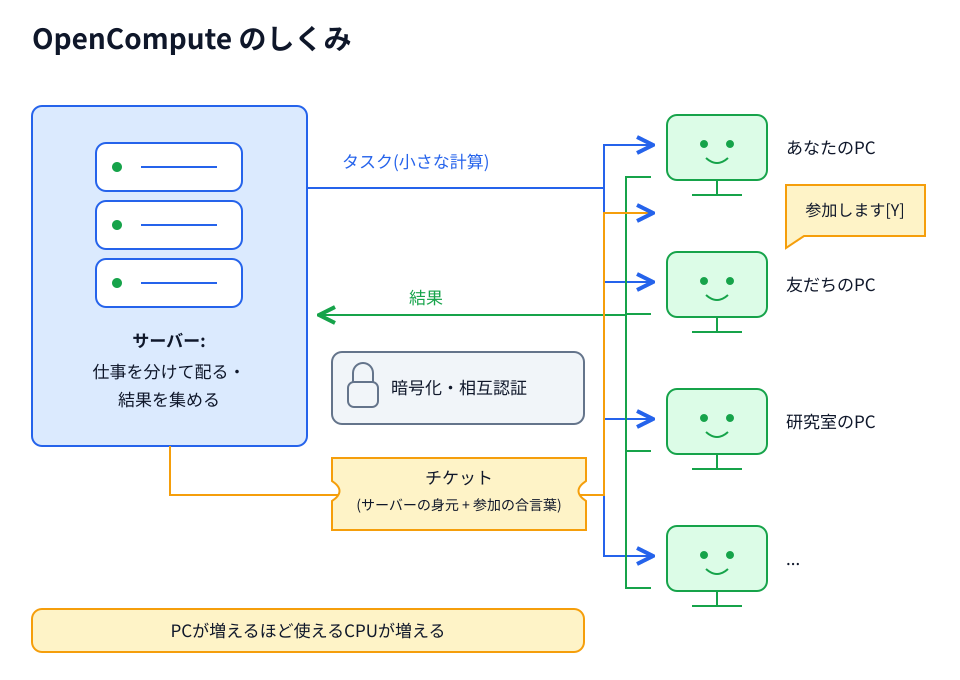

# OpenCompute ドキュメント

OpenCompute は、複数のコンピュータの CPU をネットワークでつないで、大きな計算を分担して実行する Rust 製のフレームワークです。このフォルダには、使う人・参加する人・作る人のそれぞれに向けた説明があります。

## どこから読むか

自分の立場に近い行から読み始めてください。

| あなたは | 読むもの |
|---|---|
| まず何ができるのか知りたい | [01 OpenCompute とは](01-overview.md) |
| とにかく動かしてみたい | [02 動かしてみる](02-quickstart.md) |
| 自分の PC を計算に貸したい | [06 安全性と参加者のための説明](06-safety.md) → [02 動かしてみる](02-quickstart.md) の「手順 2: クライアントを参加させる」 |
| 自分の計算プログラムを分散して動かしたい | [04 計算モジュールを書く](04-write-a-module.md) |
| 流体シミュレーションのような、ステップを繰り返す計算を分散したい | [05 繰り返し計算と流体シミュレーション](05-stateful-lbm.md) |
| サーバーを運用する | [07 運用とトラブルシューティング](07-operations.md) |
| ソースコードを読む・直す | [03 用語と基本の考え方](03-concepts.md) → [08 内部構造](08-architecture.md) → [PROTOCOL.md](PROTOCOL.md) |

## 文書の一覧

1. [OpenCompute とは](01-overview.md): 何を解決するか、誰が何をするか、今できること・できないこと
2. [動かしてみる](02-quickstart.md): 1 台の PC で試し、次に複数台、WASM、流体まで進める手順
3. [用語と基本の考え方](03-concepts.md): ノード、ジョブ、タスク、チケットなど、文書に出てくる言葉の説明
4. [計算モジュールを書く](04-write-a-module.md): Rust で書いた計算を WASM にして、クラスタで実行する方法
5. [繰り返し計算と流体シミュレーション](05-stateful-lbm.md): 領域分割、境界の交換、チェックポイント、再分割
6. [安全性と参加者のための説明](06-safety.md): 参加すると何が起き、何が起きないか
7. [運用とトラブルシューティング](07-operations.md): 保存される情報、再起動、よくある問題
8. [内部構造](08-architecture.md): クレートの構成、状態遷移、スレッドとロック
9. [PROTOCOL.md](PROTOCOL.md): 通信メッセージの仕様(英語のリファレンス)

## この文書が前提にしていること

- 記載はソースコードに基づいています。実装されていないことは「未実装」と書いてあります。
- 動作の確認は、すべて 1 台のマシン上で行いました。別々のマシン同士の LAN 接続、NAT の内側にある PC との接続、`--relay` を使った接続は確かめていません。該当する箇所には「未検証」と書いてあります。
- 図は `img/` フォルダの SVG ファイルです。ブラウザや GitHub でそのまま表示できます。
